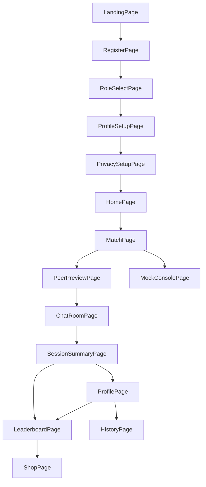
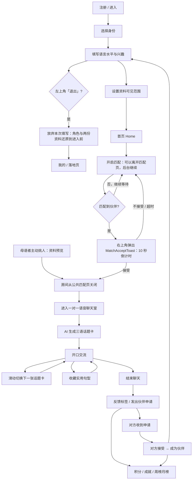
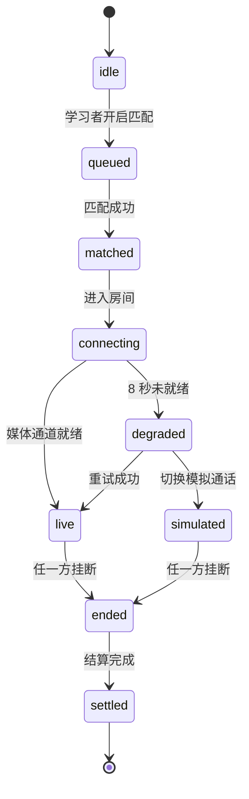
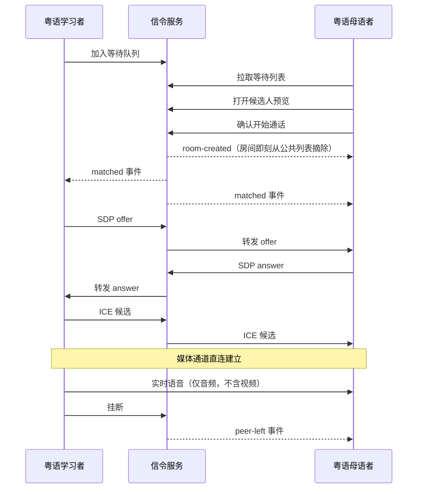

# 03 · 信息架构与页面规格

> 本文档的路由表与页面组件名是唯一真源。其它文档引用页面、路由、组件时必须与本文一致，frontend/tools/check-docs.mjs 会自动校验。

## 1. 设计原则

1. **一部手机、一只手、5 分钟。** 所有主操作落在拇指热区（屏幕下半部），任何页面都不需要横屏或双击缩放。
2. **永远给下一步。** 每个页面底部都有一个明确的主按钮；不允许出现死胡同页面。
3. **三态必须设计。** 每个异步界面都要写清 加载中 / 空 / 失败 三种表现，且失败一定带出路（重试或降级），不能只显示报错。
4. **降级不降体验。** 没有麦克风、没有网络、连不上信令，产品依然要能演完并给出正反馈。本产品**只做语音通话**（《hackathon 项目提示词》明写「只设计 Audio Call，不开发 Video Call」），所有舞台都是语音舞台。
5. **匿名是可选的隐私设置。** 新用户默认不匿名；需要隐藏 User ID 时，在「我的 → 设置」主动开启，匹配所需的信息照常展示。

## 2. 信息架构总览

## 3. 路由表（唯一真源）

| Route | 页面组件 | 访问身份 | 优先级 | 职责 |
| --- | --- | --- | --- | --- |
| `/` | `LandingPage` | 公开 | P0 | 落地页：价值主张与入口 |
| `/register` | `RegisterPage` | 公开 | P0 | 注册：本机建号 / 继续使用 / 换个人用 |
| `/onboarding/role` | `RoleSelectPage` | 公开 | P0 | 二选一：粤语学习者 / 粤语母语者 |
| `/onboarding/profile` | `ProfileSetupPage` | 两种身份 | P0 | 母语、粤语水平、兴趣与身份标签 |
| `/onboarding/privacy` | `PrivacySetupPage` | 两种身份 | P0 | 资料可见范围与实时预览 |
| `/home` | `HomePage` | 两种身份 | P0 | 首页：按当前身份给唯一主 CTA，配轻量统计与最近记录 |
| `/match` | `MatchPage` | 两种身份 | P0 | 匹配大厅：学习者等待视图 + 母语者浏览挑选视图 |
| `/match/:learnerId` | `PeerPreviewPage` | 粤语母语者 | P0 | 点开某位学习者后的资料预览与「开始通话」 |
| `/room/:roomId` | `ChatRoomPage` | 两种身份 | P0 | 一对一会话房间：语音舞台 + 话题卡 |
| `/room/:roomId/summary` | `SessionSummaryPage` | 两种身份 | P0 | 结算：积分与成就 + 反馈标签 + 是否再连线 |
| `/me` | `ProfilePage` | 两种身份 | P1 | 个人主页、成就墙、隐私入口 |
| `/leaderboard` | `LeaderboardPage` | 两种身份 | P1 | 周榜 / 月榜 |
| `/shop` | `ShopPage` | 两种身份 | P1 | 积分余额、主题兑换与收支记录 |
| `/history` | `HistoryPage` | 两种身份 | P2 | 连线记录与认识的人 |
| `/dev/mock` | `MockConsolePage` | 仅开发 | P1 | Demo 控制台，现场救场 |
| `*` | `NotFoundPage` | 公开 | P2 | 兜底页 |

**路由约定**

- 使用 `createBrowserRouter`，全部为客户端路由；部署需要 SPA 重写规则。
- 除 `/`、`/register`、`*` 与 `/dev/mock` 外，所有路由都要求内存中存在身份信息，否则重定向回身份选择页。
- **账号只在 `/register` 长出来**：落地页与注册页是「注册前路由」（app.js 的 `PRE_AUTH_ROUTES`），
  它们不调任何受保护接口、也不预登录。走完注册（或直接进受保护页面）才会拿到令牌——
  否则「显式注册」会退回成走过场，任何一台只是路过落地页的设备都会在服务端留下一个空账号。
- onboarding 完成后默认落地 `/home`；`/home` 是本产品的「主界面」，不是 dashboard。
- `/room/:roomId`、`/match/:learnerId` 与 `/dev/mock` 走路由级 lazy load，不进首屏包。
- 前三个 onboarding 路由共用 `StepProgress`，步骤标记为 1/3、2/3、3/3。
- `/match/:learnerId` 只允许粤语母语者进入；学习者误入时重定向回 `/match`。

## 4. 全局布局与导航

### 4.1 `AppShell`

所有页面共用的外壳，负责：视口宽度限制（max-width 430px 居中）、安全区适配、浅色背景（`#F5F5F7`）与白色卡片层次、全局语言切换上下文、`FallbackBanner` 挂载点。

外壳上还有一个**跨路由插槽** `toast`：匹配成功的 `MatchAcceptToast` 挂在这里，而不是挂在 `/match` 页面里。这样人走到任何页面（首页、排行、成就……）都能收到「接受 / 不接受」提示，排队与匹配引擎也随着外壳一起活着，不随页面销毁——这就是「匹配挂在后台」的实现要点。

顶部横幅有**两个槽，分属两个主人，互不覆盖**：

- `notice`：外壳所有的一次性运行时提示（「已取消匹配」「刷新后房间不在了」），挂上后一直留着，只有用户点「×」或下一次操作才消失。
- `banner`：页面自己的横幅（「离线数据」「对方已离开」），由页面在 `afterPaint` 里 `setBanner` / `clearBanner` 自行管理。

两者合用一个槽时会出事：页面数据加载成功后会 `clearBanner()` 把横幅撤掉，顺手就把外壳的提示一起抹了。所以必须是两个槽。

### 4.2 `TopBar`

左侧返回箭头（有历史时显示）、中间页面标题、右侧动作位保持空白；语言切换放在“我的 → 设置”的“界面语言”卡片。滚动时加毛玻璃背景。

**onboarding 三页的例外：** 左上角不是返回箭头，而是带文字的「退出」按钮（主色浅底 + 主色描边 + 文案说明后果）。退出是**有后果的动作**——它放弃本次填写，并把账号配置（角色 + 两份资料）还原到进入 onboarding 之前，然后回「我的」（还原后当前身份已有资料）或落地页（全新账号）。44px 的图标按钮撑不起这个含义，所以给文字标签（见 5.2 / 5.3 / 5.4）。

**刻意不放的：** 配色主题切换不放页头。页头只保留返回与标题，再塞内容会先挤标题、再顶出横向滚动；而配色是「设置一次就不动」的偏好，收进「我的」页的配色主题卡（见 5.8）更合适，界面语言也收进“我的 → 设置”。

### 4.3 `BottomNav`

仅出现在主流程之外的四个主页面，四个 Tab。会话房间与 onboarding 一律不显示，保持沉浸。

| Tab | 目标路由 | 图标语义 |
| --- | --- | --- |
| 首页 | `/home` | 房子 |
| 匹配 | `/match` | 两个相交的圆 |
| 排行 | `/leaderboard` | 柱状榜单 |
| 我的 | `/me` | 头像 |

**刻意不放的：** 不在 onboarding 与会话房间显示导航栏，那两处要的是沉浸与专注。

### 4.4 `StepProgress`

onboarding 三页顶部的一条三段式进度条，当前段用主色（Jade）高亮，已完成段用中性色，未到达段半透明。

## 5. 逐页规格

### 5.1 落地页 — 路由 `/`

**目标：** 3 秒讲清这是什么，并把用户推进身份选择。

**看到什么**

- 顶部：产品名 CantoBridge + 一句话 slogan。
- 中部插画：一座简洁的桥，两端分别是一个学习者图标与一个本地伙伴图标（不用霓虹灯牌，不做复杂渐变）。
- 两张能力卡：「真人一对一语音」「AI 三语话题卡」。
- 底部只有一个主按钮「开始使用」。**没有「我是粤语母语者，想帮手」这类身份捷径，也不向普通用户暴露开发控制台**：身份在注册第一步自己选，落地页不预设也不分流。

**点什么**

- 「开始使用」→ 去**注册页**（`/register`）；注册完成后才进身份选择页（**不预选任何一张卡**）。
  落地页自己**不建号**：账号是用户在注册页点「注册」那一刻才长出来的。
- 语言切换 → 整个外壳文案立即切换，无需刷新。
- Demo 控制台保留直达路由 `/dev/mock`，只供开发与排障使用，不占用产品入口页。

**状态**

- 加载中：插画区域显示 `LoadingSkeleton`，首屏文案立即渲染，不整页等待。
- 空：静态页面无空态；若某语言包缺 key，回退英文并在顶部挂 `FallbackBanner`。
- 失败：字体或插画加载失败时回退系统字体与 CSS 渐变，页面与按钮保持可用。

**组件：** `AppShell`、`LoadingSkeleton`、`FallbackBanner`

### 5.2 身份选择 — 路由 `/onboarding/role`

**目标：** 二选一，并让用户理解两种身份的差别。

**看到什么**

- `StepProgress` 显示 1/3。
- 两张竖排 `RoleSelectCard`：粤语学习者（副标题「我想练口语」）、粤语母语者（副标题「我讲粤语，也想练 X —— 交换」），每张只有图标 + 标题 + 一句副标题（**卡上不再列示例标签**：身份选择只回答「你是谁」，不预告兴趣）。
- 卡下方一行补充说明：**两种身份是对等的交换，不是「帮忙」。** 母语者不是老师、也不是义工；「我也想练的语言」是下一题的**可选**项，不填也能继续（见第 5.3 节与 [07-open-questions.md](07-open-questions.md) 第 9 节）。
- **这一页不做二合一身份卡**：身份卡只回答「你是谁」，回礼放在资料页的可选题里。把两者合并成一张「能教的语言 + 想学的语言」卡会改掉身份模型（`role` 是账号级的二选一），该提议已评估并被否决，理由见 07 第 9.2 / 9.3 节。
- 底部「下一步」按钮，未选择时禁用。

**点什么**

- 点卡片 → 进入选中态（主色描边 + 右上角勾），另一张自动取消选中。
- 「下一步」→ 去资料填写页。
- 「退出」（左上角，带文字）→ 放弃本次填写并还原账号配置（这一页还没写过任何字段，所以等同于「我还没准备好」），回「我的」或落地页。

**状态**

- 加载中：若上次选择的身份从存储读取，显示两张卡片骨架。
- 空：未选择时卡片下方提示「先选一个身份」，主按钮禁用。
- 失败：本地存储写入失败时不阻塞流程，仅在内存保存，并挂 `FallbackBanner` 提示本次进度不会被保存。

**组件：** `AppShell`、`StepProgress`、`RoleSelectCard`、`FallbackBanner`

### 5.3 资料与标签 — 路由 `/onboarding/profile`

**目标：** 采集匹配所需的最小标签集。**出厂不预选任何一项**：进来时每道题都是空的。

本页是**一屏一题**的分页问卷（`QuestionPager`）：学习者 5 题（母语 / 粤语水平 / 兴趣 / 学习目标 / 身份），母语者 4 题（兴趣 / 愿意聊的话题 / 身份 / **想练的语言（可选）**）。顶部进度点标出「已填（实心）/ 当前（主色）/ 未到」，右侧写「第 2 / 5 项 · 已填 3 项」；底部是「上一项 / 下一项」，**走到末项时右边那颗换成可点的「下一步」**（保存已填部分 → 进资料可见范围页）；右下角另有一颗**小号安静按钮「暂时跳过」**，任何一题都点得到。资料不是必填关卡，所以不设主按钮；分页只是减少干扰，**不制造新的关卡**。

**看到什么（粤语学习者）**

- 母语选择（下拉或芯片组）。
- 粤语水平：`LevelSelector` 四档，初学者 / 初级 / 中级 / 高级，每档带一句说明。
- 兴趣标签：`TagPicker`，可选美食、旅行、电影、动漫、音乐、运动、读书、游戏、摄影、宠物等，最多选 5 个，已选数量实时显示。
- 学习目标：预设选项（能进行日常交流 / 能听懂茶餐厅点单 / 能看懂港剧）加一个自由输入。

**看到什么（粤语母语者）**

- 兴趣标签：同一套 `TagPicker`。
- 身份标签：学生、上班族、动漫爱好者、足球爱好者等，用于让学习者判断聊不聊得来。
- 愿意讨论的话题：多选。
- **想练的语言（第 4 题，可选）**：`TagPicker`，取值普通话 / English / Other（**不含粤语**）。标题「我也想练…」，副标题写清两件事：「不填也行」与「填了会让能互相交换的人优先被排到你前面」。这是「对等交换」叙事的落点，不是必填关卡——母语者填完之后，匹配列表里母语是这门语言的学习者会排在前面并带「语言互补」徽标。

**点什么**

- 在题目卡片上**左右滑动**（或点「上一项 / 下一项」）→ 在题目之间前后移动；首项的「上一项」与末项的「下一项」置灰，滑动到边界不循环、也**不自动提交**。
- 点标签切换选中，超过 5 个时提示并阻止继续选。
- 点水平档位。
- 「**暂时跳过**」（右下角，小号安静按钮）→ 保存当前已填的部分、去资料可见范围页。资料不是必填关卡：一题没填也点得到，不必先划到最后一题；之后可以回「我的 → 编辑资料」接着改。
- 「退出」（左上角，带文字）→ 放弃本次填写：草稿丢掉，角色与两份资料还原到进入 onboarding 之前，回「我的」（还原后该身份已有资料）或落地页。

**状态**

- 加载中：标签字典来自 mock 服务，显示 chip 骨架约 300 毫秒。
- 空：一个标签都没选时「暂时跳过」仍可点，只提示「至少选 1 个兴趣，匹配会更准」，不阻塞流程。
- 失败：标签字典取不到时给 `ErrorState` + 「重试」；直接输入本页地址而没有选过身份时，按 store 里的当前身份渲染（身份是否匹配由 `/match` 等页面的守卫负责）。

**组件：** `AppShell`、`StepProgress`、`QuestionPager`、`TagPicker`、`LevelSelector`、`LoadingSkeleton`

### 5.4 资料可见范围 — 路由 `/onboarding/privacy`

**目标：** 让用户在首次匹配前明确哪些资料会展示给别人；匿名模式不在 onboarding 中询问。

**看到什么**

- 一行提示：匿名模式默认关闭，需要时可在「我的 → 设置」主动开启。
- `PrivacyToggleList`：头像、用户名、母语、粤语水平、兴趣标签，每项独立开关。
- `BuddyCard` 实时预览：别人在匹配页会看到我的什么样子。
- 底部主按钮「**完成设置**」（只把注册收尾：提交这份草稿、作废还原点，然后**回首页**。它既不把人送进匹配页、更不会把人扔进队列——想开始匹配，回首页点主按钮或底部「匹配」Tab，见 5.5）。

**点什么**

- 切任意开关 → 预览卡立即更新。
- 「完成设置」→ 收尾注册并去**首页**（见 5.13）；「退出」→ 与 5.3 相同：整段 onboarding 作废并还原（**包括资料页已经保存的那一笔**）——退出就是「这次注册不算数」。

**状态**

- 加载中：默认值来自本机出厂设置（全空 + 默认开），显示开关与预览卡骨架。
- 空：全部关闭时预览卡显示「对方只会看到：正在寻找粤语伙伴」，仍可继续。
- 失败：与 5.3 相同，未选身份则重定向。

**组件：** `AppShell`、`StepProgress`、`PrivacyToggleList`、`BuddyCard`

### 5.5 匹配大厅 — 路由 `/match`

**目标：** 让学习者被找到，让母语者挑得动；匹配成功后房间立刻从公共页摘掉。

**开始卡片（新用户与老用户走同一张）**

- **匹配前不再选兴趣**：没排队的人只看到一张很简单的卡片（`.match-start`）——标题「准备好就开始匹配」、一句说明、一个「开始匹配」按钮。**卡上没有任何标签选择器**：想改兴趣去「我的 → 编辑资料」，匹配度仍然按资料里的兴趣算。
- 「开始匹配」＝**`POST /api/match/queue`**，点一下直接入队（不再先写 `PUT /api/match/criteria`：没有需要确认的条件了）。入队之后本页**原地**换成等待面板，计时从入队那一刻起算。
- 没有必填项，所以按钮**永远可点**（旧版「一个主题都不选时禁用」的规则随兴趣选择器一起退场）。
- 页面顶部有一枚**教 / 学标签**（`.own-intent-row`）：它由「我的」页里的身份**自动派生**（粤语母语者 = 教粤语、粤语学习者 = 学粤语），旁边一句「由『我的』里的身份自动带上」。**不是可选项、也没有勾选界面**——换身份才会换标签。
- 卡片**不给「收起」**：它只有一个出路，所以底部只有一个按钮。
- 注册流程的收尾按钮叫「**完成设置**」，它只负责收尾并把人送到首页；要不要开始匹配由用户自己决定（首页主按钮或底部「匹配」Tab）。
- 只有**已经在队列里**的人回到这一页才是等待面板。排队状态活在 `store`（`runtime.queue`）里，进出不重新排队、计时不清零。

**匹配挂在后台（本轮的手感要求）**

- 排队状态放在 `store`（`runtime.queue`）里，不在页面里：离开 `/match` 去首页、看排行、翻成就，排队与匹配都照常继续。
- 回到 `/match`，等待时长接着走：**不重新排队，也不把计时清零**。
- 匹配引擎归外壳层（`AppShell` 的 `toast` 插槽）所有，所以匹配成功时**不管人在哪个页面**都会收到提示。
- 只有「取消等待」才真的退出排队；「不接受」只是跳过这一位伙伴。

**看到什么（粤语学习者）**

- `MatchWaitingPanel`：呼吸光圈动画、已等待时长（秒级跳动）、一行「按什么找人」的摘要（资料里的水平 + 兴趣，例如「初学者、动漫、美食」；资料为空时不显示这一行）、文案「正在为你寻找粤语伙伴」。
- 面板上只有一个出口：「取消匹配」（安静按钮：透明底 + 细描边 + 轻字重）。刻意不给它主 / 次按钮的视觉重量，降低误触。
- 面板里**没有条件编辑器**：「放宽匹配条件」与 `MatchCriteriaEditor` 一起退场——匹配前不再让用户勾选兴趣。
- 按固定顺序排在面板底部：mock 演示档位的超时兜底块（「等太久了？可以直接用演示伙伴」）出现时，取消按钮不会被顶走；真后端档位不显示模拟入口。
- 顶部一句提示：匹配成功后本房间会从公共列表移除，其他人无法加入。

**看到什么（粤语母语者）**

- `BuddyBrowseList`：当前正在等待的学习者列表，每条是 `BuddyCard`。
- 每张 `BuddyCard`：头像或匿名图标、母语、粤语水平、身份标签、**教 / 学标签（按对方身份派生，排在兴趣前面；这一列都是学习者，所以显示「学粤语」）**、兴趣标签（与我重合的标签高亮）、希望练习的主题，以及匹配度百分比（例如 86% Match）。
- 匿名学习者显示为「匿名伙伴」加语言 / 水平 / 身份 / 兴趣，不显示 User ID。
- 顶部切换到「我也在等」可变成等待视图。

**点什么**

- 学习者这一侧不需要做挑选：别人选中我时，右上角弹出 `MatchAcceptToast`（细条、带头像与名字、10 秒倒计时），房间同时从公共列表摘掉。
  - 点「接受」→ 直接进房 `/room/:roomId`。
  - 点「不接受」→ 弹窗收起，人留在等待队列，等待时长**不清零**（拒绝不等于退出匹配）。
  - 倒计时到点还没做选择 → 按「不接受」处理（`declineMatchRequest({ expired: true })`：人留在队列、计时不清零，对方仍可被别人摘走）。
- 倒计时上限默认 10 秒，可在 `/dev/mock` 现场调（5 / 10 / 15 / 20 秒）。
- 点任意 `BuddyCard` → 去资料预览页 `/match/:learnerId`；在预览页点「开始通话」才真正成房。
- 「取消匹配」→ 结束排队：队列清空，还没接受的匹配请求一起作废（右上角弹窗立刻收起），然后回首页并挂一条「已取消匹配」横幅。**这是唯一的退出动作**，两种身份（学习者 / 母语者的「我也在等」）都能用。
  - 不做二次确认：这是一步可逆操作，首页主按钮与底部「匹配」Tab 都能重新开始排队，横幅里也写明了这一点。
  - 正好卡在「匹配成功但还没选」的时候点，同样有效：请求与弹窗一起消失，不会被拽进房间。
- 匹配前不再自选标签：没排队时看到的就是那张开始卡片，点「开始匹配」直接入队。教 / 学标签不用管：它跟着「我的」里的身份自动来。
- 想在匹配里换口味（例如只跟喜欢动漫的人聊）→ 去「我的 → 编辑资料」改兴趣；匹配度立刻按新资料算，但**匹配页不再提供第二个修改入口**（避免同一件事有两处入口、两套状态）。

**状态**

- 加载中：`BuddyBrowseList` 显示 3 条 `LoadingSkeleton` 卡片。
- 空：无人在等待时显示 `EmptyState`「现在没有人在等，要不要先去看看成就？」，带「返回」按钮。
- 失败：匹配服务失败时显示 `ErrorState` + 「重试」；mock 演示档位等待超过 8 秒时才在面板内出现「使用演示伙伴」兜底入口。
- 取消后：页面立刻卸载，「已等待」的秒级定时器一并清掉，不留空转 interval；落地页（首页）不再有任何「正在匹配」的痕迹；回到 `/match` 看到的是开始卡片，不会被自动重新排上队。
- 未排队：等待标签页渲染的是开始卡片（`.match-start`），**没有等待面板、也没有计时**——计时从点「开始匹配」那一刻起算。
- 计时：秒级刷新由页面层的 `startWaitingTicker` 驱动（`setInterval` 1 秒，只改「已等待」那一行文字，不整页重渲染）。**两种身份都会启动**：母语者默认视图是「寻找伙伴」，但「我也在等」同样有等待面板，少了它那边的计时就只在重渲染时才跳一次。

**组件：** `AppShell`、`BottomNav`、`MatchWaitingPanel`、`BuddyBrowseList`、`BuddyCard`、`MatchAcceptToast`、`EmptyState`、`ErrorState`、`LoadingSkeleton`（`MatchCriteriaEditor` 已从这一页退场，组件本身保留但当前未接线，见 05 第 7.12 节）

### 5.6 会话房间 — 路由 `/room/:roomId`

**目标：** 产品的核心体验——听得见对方，且永远有话可说。**只做语音，不做视频**（素材 4 明写「本项目只设计 Audio Call，不开发 Video Call」）。

**看到什么**

- 上半屏 `CallStage`：语音舞台。中间是对方头像（或匿名图标），下方是 `AudioWaveform` 声波动画，随对方音量起伏；连接中显示双方头像与「正在建立连接」。
- 顶部 `RoomHeader`：对方昵称或「匿名伙伴」、通话计时、匿名徽标、连接状态点，以及一枚**房主自动标签**——按房间模式**派生**（母语者房主 = 「房主 · 教粤语」、学习者房主 = 「房主 · 学粤语」，与「我的」里的身份同源），进房即带上，房间里不提供手动切换。
- 底部 `CallControls`：麦克风开关、扬声器 / 听筒切换、挂断。**没有摄像头按钮**，因为本产品不做视频。
- 屏幕下半部 `TopicCardStack`：当前 `TopicCard` 从上到下三行——粤语（最大字号）、普通话、英文；卡片右上角显示难度档位，左上角显示 `Topic 3 of 8`，**看过的卡再挂一枚「聊过了」**。卡片下方是**牌堆进度条**（已看 / 总数，读的是真正看过几张，不是当前序号）。
- 卡片下方 `PhraseChips`：可直接照读的句型，例如我最近睇紧……、我最钟意嘅系……、你有冇睇过……；每个 chip 右侧可星标收藏（Save Phrase）。
- 卡片边缘有「左右滑动切换」的手势提示，首次进入时出现一次。

**点什么**

- 左右滑动 `TopicCardStack` 切换话题卡（核心交互，必须有手感：跟手拖拽 + 回弹 + 切卡动效）；也可以用 `‹` / `›` 两颗按钮逐张翻，**到头就置灰**，翻到最后一张时出现两颗按钮：**「再来八张」**（换一整叠新的，旧叠作废、进度归零）与**「聊完，去结算」**。
- **双方看同一张**：任一方翻卡都经信令 `room:card` 广播出去（载荷带 `cardId` / `index` / `round`），对方跟到同一张；**跟过去的一方不再回推**（否则两边来回弹）。跟过去时给一行提示（`room.followingPeer`）。
- **再来八张**：换叠时把这一叠看过的卡作为 `exclude` 传给后端、`round` 加一，于是新一叠与旧一叠**零交集**；`round` 随 `room:card` 同步给对面，对面自动取同一叠再跟到同一张。结算的「翻过几张 / 聊过哪些主题」**跨叠累计**，不会被换叠抹掉。
- 点 `PhraseChips` 中的句型 → 放大展示并高亮粤语用字；点星标 → 收进本地收藏夹。
- 点对方头像 → 展开对方的公开资料（匿名者只显示语言与水平）。
- 点挂断 → 去结算页。

**状态**

- 加载中：进入房间先显示「正在建立连接」+ 双方头像，超过 8 秒转入降级提示。
- 空：卡池聊完时显示 `EmptyState`「这一叠聊完了」，给「再来八张」（换一整叠新的）与「聊完，去结算」两条出路。
- 失败：覆盖 02 兜底矩阵相关条目，全部通过 `FallbackBanner` 与模式切换表达，不弹错误页。麦克风不可用时进「旁听模式」：对方仍在通话音轨上，话题卡照常可用。

**组件：** `AppShell`、`CallStage`、`AudioWaveform`、`CallControls`、`RoomHeader`、`TopicCardStack`、`TopicCard`、`PhraseChips`、`FallbackBanner`、`EmptyState`

### 5.7 会话结算 — 路由 `/room/:roomId/summary`

**目标：** 把「开口说话」这件事立刻兑现成正反馈。

**看到什么**

- `RewardCard`：本次通话时长、翻过几张话题卡、本次获得积分。
- 学习者看到 `summary.great`「聊得不错！」，母语者看到 `summary.buddyHeadline`「谢谢你用粤语聊了这一场」——同一份数据，两套文案。
- 新解锁的 `AchievementBadge`，带弹出动效与成就名称、解锁条件。
- 母语者额外一行提示（`summary.domainHint`）：这一场的时长会计入你的伙伴等级与积分——**回礼是可见的**，不是单向付出。
- `SessionFeedbackSheet`：先给一句轻反馈，学习者可选 Friendly / Patient / Easy to Understand / Helpful，母语者可选 Active Learner / Friendly / Willing to Speak Cantonese / Great Conversation，允许 Skip；再问一句「Would you like to connect again?」，给「发出伙伴申请」与「暂时不要」两个按钮。
- 点「发出伙伴申请」之后两个按钮收起，换成一句「伙伴申请已发出，等 ta 确认」；如果对方早就申请过我，则直接显示「你们已经是伙伴了」。**这一步只是申请，对方接受之前不会出现在「我的伙伴」里。**

**点什么**

- 点徽章 → 展开成就说明。
- 点反馈标签 → 多选切换；点「Skip」直接跳过；点「发出伙伴申请」→ 写入一条待确认的申请（不是单方面变成伙伴）。
- 「查看我的成就」→ 个人主页；「再来一次」→ 回匹配大厅。

**状态**

- 加载中：积分由 mock 服务计算，显示数字滚动占位而非空白。
- 空：通话时长过短（例如立刻挂断）时不发徽章，显示「下次聊久一点就能点亮新成就」。
- 失败：结算失败时前端按通话时长本地估算并照常展示，同时挂 `FallbackBanner` 标注为离线估算；伙伴申请发送失败时按钮回到可点状态并提示重试，不写半条脏数据。

**组件：** `AppShell`、`RewardCard`、`AchievementBadge`、`SessionFeedbackSheet`、`FallbackBanner`

### 5.8 个人主页 — 路由 `/me`

**目标：** 让用户看见自己的积累，并集中管理隐私。

**看到什么**

- 顶部头像、昵称、身份徽标。
- **「我也想练」卡（`me.wantToLearn`，仅粤语母语者可见）**：与资料页第 4 题同一份数据、同一套取值（普通话 / English / Other，**不含粤语**），紧跟身份卡，随时可改；填了会让能互相交换的人优先排到你前面。学习者的「想练」恒为粤语、由身份自带，所以这一块对学习者不显示。
- 统计区：累计练习时长、认识了多少位伙伴、连续练习天数。
- **「我的伙伴」插槽**（`BuddyRequestList`）：伙伴关系的唯一管理入口，分三组显示——
  - 收到的申请：显示对方名字 + 「待你确认」，右侧 `接受` / `拒绝`。
  - 我发出的申请：显示对方名字 + 「等待对方确认」，右侧 `撤回申请`。
  - 已连接的伙伴：显示对方名字 + 「互相确认的伙伴」，右侧 `解除伙伴`。
- `AchievementWall` 成就墙：已解锁徽章高亮，未解锁灰显并标注解锁条件。
- **设置区的匿名开关行**（匿名功能的唯一入口；新用户默认关闭，伙伴申请、匹配页与排行榜共用同一个值）。
- **配色主题卡**（`ThemeSwitch`，全站唯一的配色入口）：一行两张药丸——「薄荷绿」（浅灰底 + Jade 绿，默认）与「暖橙」（米黄底 + 明橙按钮），每张左边带一个 12px 色点。换主题只换配色，不动任何数据。
- 操作区：编辑资料、隐私设置、连线记录、排行榜。

**点什么**

- 点 `接受` → 那一行立刻从「收到的申请」移到「已连接的伙伴」。
- 点 `拒绝` / `撤回申请` → 申请直接消失，回到没有关系。
- 点 `解除伙伴` → 只解除关系，通话记录与积分保留。
- 切换匿名开关 → 立即影响匹配页与排行榜的展示。
- 点「我也想练」里的标签 → 就地写进 `buddyProfile.wantToLearn`（`PUT /api/me/profile/buddy`），不用回资料页；它只改排序权重，不筛选、不是关卡。
- 点「薄荷绿」/「暖橙」→ 整站立刻换色（页头、卡片、按钮、话题卡一起变），选中项同时反白；选择写进 `settings.theme` 并持久化，刷新后还在。
- 「编辑资料」→ 资料填写页；「隐私设置」→ 隐私页；「连线记录」→ 记录页；「排行榜」→ 榜单页。
- 「切换为…」→ 目标身份**第一次**使用时直接进资料填写页的第 2 步（点「切换」就等于已经选好第 1 步的身份，不再等用户点「匹配」被守卫弹回来），填完才真正切换；中途按「退出」会回到切换前的角色与两份资料。目标身份已经填过资料时，按钮只是原地切换身份，不打断手头的事——两种情况的区别会写在按钮下方那句提示里。

**状态**

- 加载中：整页骨架，头像与徽章用占位块；插槽内用 `LoadingSkeleton` 的 `list` 变体占位。
- 空：新用户 0 成就时全部灰显，并显示「完成第一次聊天就能点亮第 1 枚徽章」；伙伴插槽为空时给一句可执行引导「还没有伙伴——聊完一场，发出第一份伙伴申请吧」。
- 失败：资料或伙伴列表读取失败时显示 `ErrorState` + 「重试」（只有伙伴列表失败时只影响插槽那一块），底部导航保持可用。

**组件：** `AppShell`、`BottomNav`、`BuddyRequestList`、`AchievementWall`、`AchievementBadge`、`ThemeSwitch`、`EmptyState`、`ErrorState`、`LoadingSkeleton`

### 5.9 排行榜 — 路由 `/leaderboard`

**目标：** 提供外部激励，同时保证可以完全退出。

**看到什么**

- 顶部周榜 / 月榜切换。
- 两张榜：伙伴榜（粤语母语者，按对话时长排序）、学习者榜（粤语学习者，按练习时长排序）——文案 key 是 `leaderboard.buddies` 与 `leaderboard.learners`。
- `LeaderboardList` 每行：名次、头像或匿名图标、昵称或「匿名伙伴」、累计时长。
- 我的名次吸底固定，即使不在前列也能看到。
- 一行说明：可以在个人主页关闭公开展示。

**点什么**

- 切换周榜 / 月榜 → 列表重排。
- 点自己那一行 → 去个人主页。

**状态**

- 加载中：列表显示 5 行骨架。
- 空：本期无数据时显示 `EmptyState`「本期还没有数据，快去聊一场」。
- 失败：显示 `ErrorState` + 「重试」。

**组件：** `AppShell`、`BottomNav`、`LeaderboardList`、`EmptyState`、`ErrorState`、`LoadingSkeleton`

### 5.10 连线记录 — 路由 `/history`

**目标：** 让练习留下痕迹，并能标记「聊得来的人」。

**看到什么**

- 按时间倒序的会话列表：对方（匿名则显示匿名伙伴）、日期、时长、翻过几张卡，以及行尾的**伙伴状态药丸**。
- 伙伴状态与 `/me` 的插槽同源（都走 `lib/logic.js` 的 `buddyRelation`）：没关系的显示「申请成为伙伴」，我申请过的显示「等待对方确认」，对方申请我的显示「待你确认」，已互相接受的显示「已连接的伙伴」。历史条目本身**不存**这个布尔值，避免记录与真实关系脱节。
- 顶部筛选「只看我的伙伴」。

**点什么**

- 点条目 → 展开本次聊过的话题卡标题。
- 点行尾按钮 → 申请成为伙伴 / 撤回申请 / 接受 / 拒绝 / 解除伙伴，写入后列表立即刷新。

**状态**

- 加载中：骨架列表 3 条。
- 空：显示 `EmptyState`「还没有通话记录，去匹配一次吧」。
- 失败：显示 `ErrorState` + 「重试」，底部导航保持可用。

**组件：** `AppShell`、`BottomNav`、`EmptyState`、`ErrorState`、`LoadingSkeleton`

### 5.11 Demo 控制台 — 路由 `/dev/mock`

**目标：** 现场救场。演示搭档没到、网络不好、话题卡不合适，都能在这里一键改掉。

**看到什么**

- `MockControlPanel`：当前身份切换、匹配延迟（0 秒 / 0.4 秒 / 1.5 秒 / 3 秒）、是否自动匹配成功、**后台匹配开关**、**接受弹窗倒计时上限（5 / 10 / 15 / 20 秒）**、**配色主题（薄荷绿 / 暖橙）**、话题卡难度档位、信令模式（本地 / 远端 / 模拟通话）、一键重置演示数据、直接跳转任意路由的快捷入口。
- 面板顶部显示当前生效的 mock 开关摘要，方便演示时口述。
- 动作区里的「模拟匹配成功」等价于服务端推一条 `match:matched`：在任何页面上都会弹出 `MatchAcceptToast`，用来救场或者对着倒计时讲设计。

**点什么**

- 所有开关即时生效，不需要刷新页面。

**状态**

- 加载中：无（纯本地）。
- 空：无。
- 失败：无。仅在非开发构建下访问时显示 `ErrorState`「该页面仅在开发环境可用」并拒绝渲染面板。

**组件：** `AppShell`、`MockControlPanel`、`ErrorState`

### 5.12 兜底页 — 路由 `*`

**目标：** 任何迷路都不出现空白页。

**看到什么**

- 一句「这条路走不通」+ 一个「回到首页」按钮。
- 若有 referrer，附加「返回上一页」。

**状态**

- 加载中：不适用，静态渲染。
- 空：不适用。
- 失败：不适用。本页自身就是失败兜底，不依赖任何异步数据。

**组件：** `AppShell`

### 5.13 首页 — 路由 `/home`

**目标：** 用一句话说清「现在该干什么」，并把身份差异落在唯一的主 CTA 上。

**看到什么（粤语学习者）**

- `HomeActionCard`：一句「Ready to practise Cantonese?」+ 主按钮「Start a Conversation」。
- **「推荐伙伴」块（2026-09-29 新增）**：紧跟主 CTA，直接列 3 位此刻正在等的粤语母语者（复用 `BuddyCard` 行样式：匹配度百分比、「语言互补」徽标、2~3 个共同兴趣标签）。上方一句话说明「按你的兴趣和想练的方向排的」。这一块是**反单边发起**：不再要求学习者先去匹配页排队、等别人来挑（见 [07-open-questions.md](07-open-questions.md) 第 9.5 节）。
- `StatTile` 一行四块：Practice Time This Week、Conversations、Current Streak、Achievements。
- 「Recent Connections」横向一小排最近聊过的人，匿名者显示为「匿名伙伴」。
- `BottomNav` 固定在底部。

**看到什么（粤语母语者）**

- `HomeActionCard` 换成「有人正在等一位粤语伙伴」+ 主按钮「Find Someone to Talk With」，按钮下方一行小字「现在有 N 人正在等」。
- `StatTile` 换成 Conversation Hours、People Helped、Buddy Level、Achievements。

**点什么**

- 点主按钮 → 去 `/match`；学习者自动进入等待状态，母语者直接进入浏览视图。
- 点推荐块里某一位的「直接聊」→ **直接成房**并进入 `/room/:roomId`，该房间同时从别人的推荐与匹配页摘除（与母语者挑人后的行为一致）。**不经过资料预览页**：`/match/:learnerId` 的守卫是「只允许粤语母语者进入」（见第 3 节路由约定），而且学习者需要的信息（匹配度、共同兴趣、互补徽标）已经全在卡片上了。
- 点推荐块的「看全部 / 我也去排队」→ 去 `/match` 的等待视图。
- 点 `StatTile` → 去 `/me`；点成就那块 → 去 `/me` 的成就墙。
- 点 Recent Connections 里的某个人 → 去 `/history`。

**状态**

- 加载中：`HomeActionCard` 立即渲染（文案不依赖数据），`StatTile`、推荐伙伴块与 Recent Connections 显示骨架（推荐块是 3 行卡骨架）。
- 空：新用户统计全 0，Recent Connections 显示「还没有聊过，先来一场」，主 CTA 复用同一按钮；**推荐块的空态单独处理**——此刻没有人在等时，整块收成一行「现在还没有人在等，先去匹配页排队也一样」+ 一个去 `/match` 的按钮，不用整屏空态：首页不能因为一个模块没数据就变成空白页。
- 失败：统计读取失败时用本地缓存值渲染，并在卡片角落标注「离线数据」；主 CTA 永远可用。**推荐块失败不影响其它模块**：整块收起只留一行「推荐暂时取不到，去匹配页看看」。

**组件：** `AppShell`、`TopBar`、`BottomNav`、`HomeActionCard`、`StatTile`、`BuddyCard`、`BuddyBrowseList`、`LoadingSkeleton`、`FallbackBanner`

### 5.14 对方资料预览 — 路由 `/match/:learnerId`

**目标：** 母语者在决定「要不要跟这个人聊」之前，先看清对方是谁（在隐私允许的范围内），避免盲选带来的尴尬。

**看到什么**

- `ProfilePreviewCard`：大号对方卡片。匿名时标题为「匿名伙伴」，显示母语、粤语水平、身份标签、**教 / 学标签（按对方身份派生）**、兴趣标签、愿意聊的主题，以及匹配度百分比与两三条「为什么会匹配」的理由（共同兴趣高亮）。
- 隐私边界提示：对方关闭了某项时，这里**直接不显示该项**，只留一句「对方没有公开这一项」。
- 底部两个按钮：主按钮「Start Conversation」，次按钮「返回列表」。

**点什么**

- 点「Start Conversation」→ 成房并进入 `/room/:roomId`；成房瞬间这个房间从公共匹配页摘掉，别人加不进来。
- 点「返回列表」→ 回 `/match`，列表保持原来的滚动位置。
- 点某个兴趣标签 → 不跳转，只在标签下方展开一张与之相关的话题卡预览，作为「等下聊什么」的预告。

**状态**

- 加载中：`ProfilePreviewCard` 显示骨架（头像块 + 4 行文字块），底部主按钮禁用并显示「加载中」。
- 空：该学习者已被别人挑走（房间已关闭）时显示 `EmptyState`「这位伙伴已经开始聊天了」+「返回列表」。
- 失败：预览读取失败时用列表页已有的卡片数据本地渲染摘要，主按钮仍可用，缺项显示为「未公开」。

**组件：** `AppShell`、`ProfilePreviewCard`、`LoadingSkeleton`、`EmptyState`、`FallbackBanner`

### 5.15 注册 — 路由 `/register`

> **编号说明：** 这一页按流程排在 5.1 与 5.2 之间，但**故意接在 5.14 之后**。
> 它是一版新加的页面，编号插在中间会把后面所有小节（5.2 → 5.15）连带全篇重排，
> 而 03 的小节号被 05 / 06 / 09 与源码注释引用了十来处——重排的收益只有「看起来顺」，
> 代价是一批静默失效的交叉引用。编号服从引用，流程顺序看路由表。

**目标：** 把「账号」做成用户真的按下去的一步，并承担同一台手机换人的入口。

**看到什么**

- 标题「注册账号」+ 一句说明：**一台设备一个账号、不需要密码**，注册后这台设备会记住你。
- 一张信息卡只显示当前状态——「这台设备还没有注册过」或「已经注册过」；不向普通用户暴露设备 id 等技术编号。
- 本机未注册：主按钮「注册并开始」，下面一行小字说明随时可以在「我的」页退出。
- 本机已注册：主按钮变成「继续使用」（回首页），另加一个安静按钮「换个人用」。

**点什么**

- 「注册并开始」→ 真去建号（`POST /api/auth/session` 带 `deviceId`）→ 去身份选择页。
- 「继续使用」→ 复用这台设备原来的账号 → 去首页。
- 「换个人用」→ 先展开二次确认；确认后作废服务端会话 + 清本机存档 + **换一把新设备 id** → 回落地页
  （下一个人可以自己注册。旧账号仍留在服务端，演示时用控制台重置）。
- 左上角「返回」→ 回落地页，**不建号**。

**状态**

- 加载中：本页不取数（只读本机存档），所以没有骨架屏；按下按钮后进入等待态，按钮文案变「注册中……」并禁用。
- 空：本机尚未注册时，信息卡显示「这台设备还没有注册过」，主按钮为「注册并开始」。
- 失败：建号失败（后端没起 / 网络断）时**留在本页**，按钮下方挂一行提示，按钮恢复可用以便重试；
  绝不跳走，否则用户会以为是页面坏了。

**组件：** `AppShell`、`FallbackBanner`

## 6. 关键流程图

### 6.1 完整用户旅程

### 6.2 会话房间状态机

### 6.3 通话建立时序

## 7. 跨页共享状态

| Store | 字段 | 生命周期 | 说明 |
| --- | --- | --- | --- |
| `sessionStore` | 当前身份（learner / buddy）、鉴权令牌、界面语言 | 持久化到 localStorage | 刷新后仍在；切换身份只改这一个字段 |
| `profileStore` | `learnerProfile`、`buddyProfile`、隐私与设置开关、配色主题（settings.theme） | 持久化到 localStorage | **两种身份的资料分开保存**，来回切换不丢数据 |
| `onboardingStore` | onboarding 的还原点（`runtime.onboarding`：进入前的角色 + 两份资料） | 内存（刷新即丢） | 退出 onboarding 时按它**整段还原**；三页之间来回走不会覆盖它，走完隐私页的「完成设置」即作废。它不是「返回上一步」：只在左上角「退出」时生效 |
| `socialStore` | `buddies`（已互相接受的伙伴）、`buddyRequests`（待确认的申请，含 direction）、通话记录、收藏的句型 | 持久化到 localStorage | 伙伴关系是**双向**的：结算页只「发出申请」，接受 / 拒绝在 `/me` 的「我的伙伴」插槽与 `/history` 完成；旧存档缺少新字段时按默认值合并 |
| `matchStore` | 排队状态（`queue`）、待接受的匹配请求（`matchRequest`）、匹配条件、等待开始时间 | 内存 | **跨页面存活**：离开 `/match` 继续排队与匹配，等待计时不清零；进房 / 取消匹配 / 重置演示数据才清掉 |
| `noticeStore` | 外壳一次性运行时提示（`notice`：`messageKey` / `tone` / `shown`） | 内存 | 由路由守卫（「刷新后房间不在了」）与「取消匹配」写入，渲染成外壳 `notice` 槽里的横幅，用户点「×」才清掉；**与页面自己的 `banner` 分槽**，页面 `clearBanner()` 不会误伤它 |
| `roomStore` | 房间号、对方信息、话题卡牌堆、当前卡序号、通话状态、通话模式 | 内存 | 刷新即丢失，此时走兜底矩阵第 9 条 |
| `rewardStore` | 本次时长、翻卡数、新增积分、解锁成就 | 内存 + 落库（mock） | 结算页读取 |
| `uiStore` | 当前语言、reduced-motion 偏好、全屏状态 | 内存 + localStorage（语言） | —— |

### 5.16 积分商城 — 路由 `/shop`

“我的”页头像资料卡下方提供整张可点击的醒目“积分商城”卡片，商城包含“主题”“头像”“配饰”三个专栏。主题区展示余额、兑换主题和收支记录，头像与配饰均支持预览、兑换和主动使用。点击主题的“预览”进入示例首页，展示该主题的页面、卡片、文字与按钮配色；零积分也能预览，退出后不改变现有配色或余额。点击返回回“我的”页；直接打开商城也可以返回。兑换仍需再次确认，余额不足禁用兑换按钮。

- 加载中：展示商城骨架。
- 空：无积分时余额为 0，仍展示商品及积分不足提示；没有收支记录时隐藏记录列表。
- 失败：商城不可用或网络失败显示对应提示与重试按钮；保留返回入口，不影响排行榜。

显示布局：由 CSS 媒体查询按视口宽度自动适配。窄于 900px 使用手机布局，达到 900px 后自动展开为最大 1180px 的电脑布局，首页和个人页重排卡片，商城双列商品，导航使用浮动栏。窗口变化即时切换，不提供手动按钮，也不保存显示模式。

预设头像：注册页通过 `AvatarPicker` 选择三个免费初始头像；编辑资料同样使用 `AvatarPicker`，未兑换头像灰色禁用。个人页、匹配与房间通过 `PresetAvatar` 显示统一头像；商城提供独立头像预览与永久兑换，配饰提供奶茶、菠萝包和叮叮车小徽章。

模拟聊天室：仅 mock 演示控制台提供显式体验入口，使用 roomId=demo-preview 复用 ChatRoomPage；正式匹配页不混入演示卡片。体验数据仅存独立内存 store，服务层只用独立 Mock API，语音模式固定 sim；刷新重建模拟房间，结束或返回大厅时释放会话。不会产生真人候选、真实房间、账号记录或积分。真实排队与通话中禁止进入，原 room 守卫对真实房间仍然生效。

模拟结算：体验房间结束后保留独立内存会话并复用 SessionSummaryPage，展示体验时长、看卡数量、模拟积分与成就。评价与伙伴申请仍只调用独立 Mock API。再次体验重建模拟数据，退出回匹配大厅；刷新后若无内存结算则重建模拟房间，不影响正式账号。

外观选择流程：注册页只建号，资料问卷最后一项独立选择头像（学习者第 6 项、母语者第 4 项）。新用户只显示三个免费头像；编辑资料最后一项同时展示头像和小徽章。其他题目不渲染外观面板，跳过资料先进入头像步骤，再保存并继续可见范围设置。
