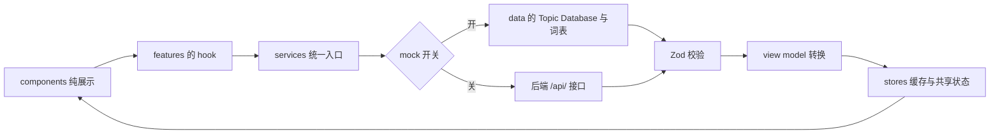
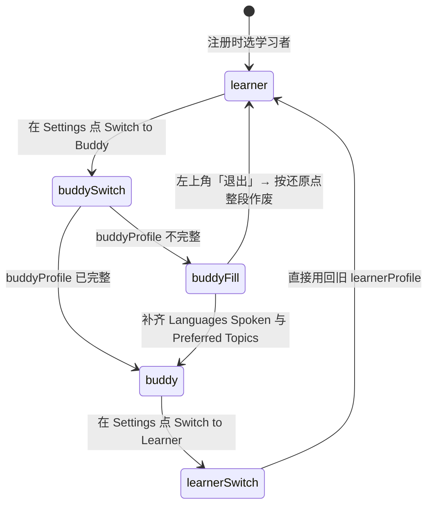
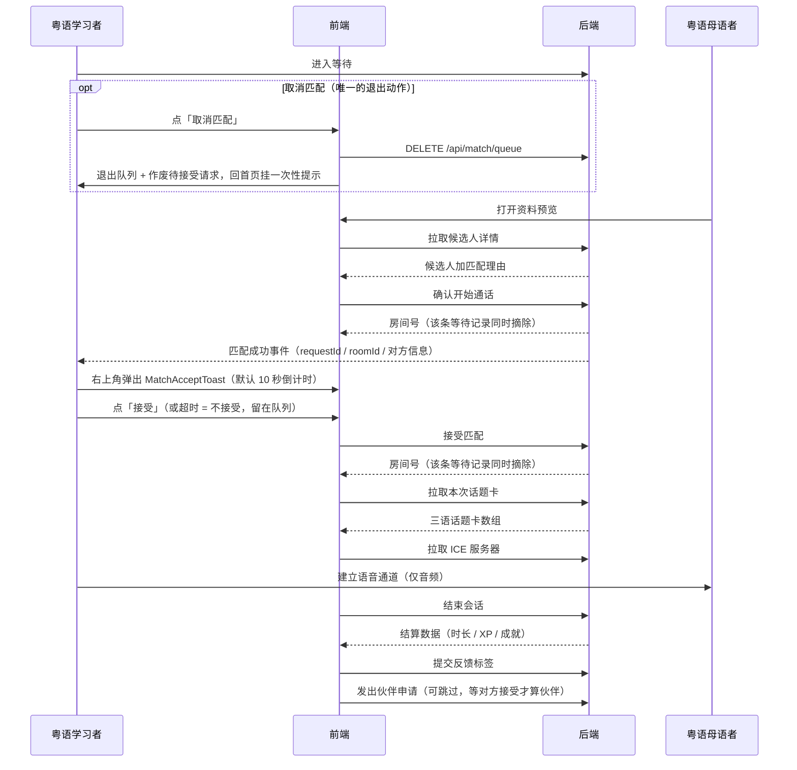

# 09 · 前端逻辑拆分与前后端接口契约

> 素材 4《hackathon 项目提示词》到位后，产品形态、匹配方式、通话形态与视觉方向都有了明确结论。本文把「项目提示词」翻译成可施工的前端逻辑，并回答三个问题：
>
> 1. **前端要怎么设计**（第 2 节）
> 2. **后端提供哪些接口**（第 3 节）
> 3. **前后端如何对接**（第 4 节）
>
> 本文第 3.2 节是**路径级唯一真源**：其它文档里出现的 `/api/...` 路径必须在本文件第 3.2 节声明，由 `frontend/tools/check-docs.mjs` 自动校验。**字段级唯一真源是 [10-api-v1.md](10-api-v1.md)**（每个端点的请求 / 响应字段、枚举、错误码与 DTO 示例），两边的端点集合由 `frontend/tools/check-api.mjs` 双向比对。

## 1. 素材依据与本次收敛的结论

素材优先级：《框架规划》（产品定义权威）→《hackathon 项目提示词》（同一作者更晚的实现级指令）→ 赛道定义图 → 早期头脑风暴长图（已废弃）。

PDF 里有几处明确留问的地方，素材 4 给出结论，本文按素材 4 收敛：

| 编号 | PDF 里的疑问 | 素材 4 的结论 | 对前端的影响 |
| --- | --- | --- | --- |
| 1 | 「视频连线 or 语音连线？」 | **只做 Audio Call，不开发 Video Call** | 舞台组件只做语音形态，没有摄像头相关逻辑与权限 |
| 2 | 「随机 / 挑选 / 预约」三种匹配 | **初版全部手动**：学习者等待，母语者按标签自己挑 | 不做随机与预约两种方式，只渲染等待列表 + 匹配度百分比。**2026-09-29 补充**：母语者视角新增一层「语言互补」**软权重**（只加权不筛选），见 07 第 9.4 节 |
| 3 | 「匿名的话我们怎么匹配？」 | 匿名只隐藏身份信息，**匹配所需信息照常展示** | 列表与预览里出现「匿名伙伴」形态 |
| 4 | 「是否可以随时解除匿名？」 | 可以，在 Profile / Settings 里随时切 | 隐私是设置项，不是一次性开关 |
| 5 | 「是不是需要一个英文名？」 | **CantoBridge**，中文名待定 | 界面只用英文名 |
| 6 | 头像 | **不做头像系统**，用占位图标 | 省掉上传、裁剪、存储三项工作 |
| 7 | 界面语言 | **简体中文 / 繁體中文 / English** | 与「粤语用字」分离，见 03 与 04 |

## 2. 前端要怎么设计

### 2.1 分层：六层，不互相越界

| 层 | 目录 | 职责 | 不许做什么 |
| --- | --- | --- | --- |
| 路由层 | `src/app/` | 路由表、`AppShell`、Provider、鉴权门 | 不写业务判断，只做组合与守卫 |
| 页面层 | `src/pages/` | 每个路由一个薄页面：装配 feature 容器与组件，处理页面级三态 | 不直接 fetch，不写数据结构转换 |
| 领域层 | `src/features/` | 按领域切分（onboarding / home / match / room / reward / profile），放 hooks 与流程编排 | 不碰 `fetch`，只调用 service |
| 服务层 | `src/services/` | **唯一**数据入口，mock 与真实 HTTP 同签名 | 不 import React，不读 store |
| 数据层 | `src/data/` | Topic Database、词表、成就定义（**没有 fixtures**，见 4.1） | 不含 HTTP 调用 |
| 展示层 | `src/components/` | 05 的 38 个组件，纯 props 驱动 | 不直接调用 service，不发请求 |

另有 `src/stores/`（Zustand，见 2.7）、`src/types/`（DTO 与 view model 的类型）、`src/i18n/`、`src/lib/`（WebRTC 封装、格式化、标签交集计算）。

**为什么这样分：** 素材 4 要求「Mock Data 与 UI Logic 分离」「AI Mock Generator 独立成 service」「不要写成一个巨大 Component」。六层正好把这三句话落成硬边界：想看 UI 只读 `components/`，想换后端只改 `services/`，想改卡池只改 `data/`。

### 2.2 目录结构

```text
frontend/
  docs/                 本套规划文档（01 ～ 10）
  tools/                文档一致性校验
  src/
    app/                路由表、AppShell、Provider、路由守卫
    pages/              路由级页面，与 03 的路由表一一对应
    features/           onboarding | home | match | preview | room | reward | profile | history | leaderboard
    components/         05 的组件清单
    services/           index.ts（按开关切 mock / http）、mock/、http/、dto 校验
    data/               topic database、词表、成就定义
    types/              DTO 与 view model
    stores/             Zustand stores
    i18n/               zh-Hans / zh-Hant / en 三个语言包
    styles/             设计 token 与全局样式
    lib/                WebRTC 封装、格式化、标签交集、匿名化
```

### 2.3 一条数据怎么流动



关键约定：**view model 转换只发生在一处**（`src/lib/`），组件永远拿不到原始 DTO。匿名化、匹配度、难度档位、时长文案都在这一步算好。

### 2.4 页面 ↔ 提示词章节 ↔ 路由 ↔ 主要数据来源

| 提示词章节 | 路由 | 页面组件 | 主要 service 调用 |
| --- | --- | --- | --- |
| §3 Landing | `/` | `LandingPage` | 无（静态 + 语言包） |
| §3 注册 | `/register` | `RegisterPage` | `signIn`（点「注册」才建号）、`signOut`（换个人用） |
| §3 身份选择 | `/onboarding/role` | `RoleSelectPage` | 无 |
| §4 注册资料与 Tags | `/onboarding/profile` | `ProfileSetupPage` | `getTags` |
| §6 资料可见范围 | `/onboarding/privacy` | `PrivacySetupPage` | `updateSettings`（只改 `visibility`；匿名在 `/me` 设置区） |
| §7 Home | `/home` | `HomePage` | `getProgress`、`getHistory`；学习者视角另有 `listRecommendedBuddies`（推荐块）与 `createRoomWithBuddy`（一键成房） |
| §8 匹配（手动） | `/match` | `MatchPage` | `joinQueue`（点「开始匹配」直接入队）、`leaveQueue`、`listWaitingLearners`、`listRecommendedBuddies`；匹配成功后由全局弹窗调 `acceptMatchRequest` / `declineMatchRequest` |
| §9 选人 | `/match/:learnerId` | `PeerPreviewPage` | `getCandidate`、`createRoom` |
| §10 语音聊天室 | `/room/:roomId` | `ChatRoomPage` | `getRoom`、`getCards`、信令 WebSocket |
| §11–12 话题卡 | 同上 | 同上 | `getCards`、`savePhrase` |
| §13 结束与正反馈 | `/room/:roomId/summary` | `SessionSummaryPage` | `endRoom`、`sendFeedback`、`sendBuddyRequest` |
| §5 Profile / Settings | `/me` | `ProfilePage` | `getMe`、`updateProfile`、`updateSettings`、`listBuddies`、`listBuddyRequests` |
| §14 排行榜 | `/leaderboard` | `LeaderboardPage` | `getLeaderboard` |
| §13 认识的人 | `/history` | `HistoryPage` | `getHistory`、`listBuddies`、`listBuddyRequests` |
| —— Demo 救场 | `/dev/mock` | `MockConsolePage` | 直接操作 mock 开关，不走网络 |

配套的逐页元素与三态写在 [03-ia-and-pages.md](03-ia-and-pages.md)，本文不重复。

### 2.5 关键页面逻辑

**首页按身份分叉。** `HomePage` 只读 `sessionStore.role`，决定 `HomeActionCard` 的文案与目标：学习者 → 「Start a Conversation」→ `/match`（落在那里的**开始卡片**上：点 CTA 本身不会把人排上队，要用户自己点「开始匹配」才入队）；母语者 → 「Find Someone to Talk With」→ `/match` 的浏览视图。两种身份的数据（`learnerProfile` / `buddyProfile`）都已在 `profileStore` 里，切换身份**不重新拉取、不丢数据**。

**匹配页是一个组件的两种视图。** `MatchPage` 读 `sessionStore.role`：学习者渲染 `MatchWaitingPanel`（等待态、超时兜底），母语者渲染 `BuddyBrowseList`（等待者列表、下拉刷新、空态）。同一路由，两种身份看到完全不同的东西。进入 `/match` **不等于**「我要开始匹配」：没排队的人渲染的是一张**开始卡片**（`matchStartCard`，只有说明 +「开始匹配」一个按钮），点它才 `joinQueue()`，入队之后本页原地换成 `MatchWaitingPanel`（计时从入队那一刻起算）。**匹配前不再让用户勾选兴趣主题**：想改口味去「我的 → 编辑资料」，匹配度仍然按资料里的兴趣算。**唯一的退出动作**是等待面板上的「取消匹配」→ `leaveQueue()` + 回首页 + 一条一次性提示横幅；「不接受」只跳过当前这位伙伴，不算退出。等待面板里**没有条件编辑器**，也没有「放宽匹配条件」：`MatchCriteriaEditor` 与 `settings.matchCriteria` 都保留但当前未接线（见 05 第 7.12 节）。页面上那枚**教 / 学标签是派生的**（`intentForRole(state.role)`：粤语母语者 = 教粤语、粤语学习者 = 学粤语）——它跟着「我的」页里的身份走，**不进设置、不给选择开关**：在「我的」页（或演示控制台）换身份，标签自己就换。等待列表里每个人身上的标签同样按**对方的**身份派生。房间头部那枚「房主 · 教粤语 / 学粤语」徽标用的是同一个函数。改条件时等待计时不清零（改了口味不该假装回到起点）。等待面板的秒级计时由页面层的 `startWaitingTicker` 驱动（1 秒一次，只改那一行文字、不整页重渲染），**两种身份都会启动**——母语者默认视图是浏览列表，但「我也在等」的等待面板一样要跳字，计时器缺了那边就只在重渲染时才动。

**匹配成功的弹窗不归这一页。** 被别人选中时弹的 `MatchAcceptToast` 挂在 `AppShell` 的 `toast` 插槽上，由 app 层的后台匹配引擎驱动：排队状态与匹配定时器都活在 store / 外壳层，**不随 `/match` 页面销毁**。所以离开匹配页之后排队继续、等待计时不清零，匹配成功时人在哪个页面就在哪个页面收到提示。这是本轮「手感」改造的核心，代价是 `MatchPage` 只负责「展示 + 手动救场」，不再自己持有匹配流程。

**房间是一个显式状态机。** 顺序固定：`idle → connecting → live → ended → settled`，任何一步失败都降级而不是中断（详见 03 第 6.2 节）。前端要保证：**只要进了房间，就一定能走到结算并拿到正反馈**，因为这是 demo 的情绪高点。

**结算页是两步，都可跳过。** 第一步 `RewardCard`（时长 / XP / 成就），第二步 `SessionFeedbackSheet`（反馈标签 → 是否再连线）。两步都可以 Skip，且「回首页」永远是可用出路。

### 2.6 双身份资料的存与切换



- `sessionStore.role` 是唯一的当前身份；`profileStore` 里 `learnerProfile` 与 `buddyProfile` 各自独立持久化到 localStorage。
- 首次切到某身份且资料不完整时：点「切换」**直接进资料页（onboarding 第 2 步）**——点这一下就等于已经选好了第 1 步的身份；填完再进隐私页收尾。中途左上角「退出」按 `runtime.onboarding` 还原点**整段作废**（角色 + 两份资料都回到进入之前），见 03 第 5.8 节与 07 的 Q-G25。
- 切换身份**不清空**另一身份的数据，也不重新注册账号。
- 母语者资料多一个**可选**字段 `buddyProfile.wantToLearn`（「我也想练 X」，取值复用 `NATIVE_LANGUAGES`，**不含粤语**）：资料页第 4 题，不填也能点「完成」。它只进排序权重——`matchRank` = `matchScore` + 互补加成（命中 +8），**只加权不筛选**，不互补的人照样出现在列表里；界面上靠「语言互补」徽标让这条排序看得见。学习者的「想练」恒为粤语（`LEARNER_WANT_TO_LEARN`），是身份自带的、不落库，所以**学习者侧的排序与纯 `matchScore` 一致**。

### 2.7 状态分工

| 状态 | 放在哪 | 理由 |
| --- | --- | --- |
| 当前身份、鉴权令牌、界面语言 | `sessionStore`（持久化） | 全局要用，刷新不能丢 |
| `learnerProfile`、`buddyProfile`、隐私开关 | `profileStore`（持久化） | 两种身份分开存，切换不丢 |
| 连线记录、收藏的句型 | `socialStore`（持久化） | 记录页与结算页读写 |
| 自定义匹配条件（勾了哪些主题） | `settings`（持久化） | 字段仍在（`null` = 按资料里的兴趣找），但**匹配页已经不再写入**：兴趣只在「我的 → 编辑资料」里维护，避免同一件事两处入口 |
| 排队状态、待接受的匹配请求、等待者列表 | `matchStore`（内存） | **跨页面存活**：离开匹配页继续排队与匹配、等待计时不清零；进房 / 取消匹配 / 重置演示数据才清掉 |
| 外壳一次性运行时提示（`notice`） | 内存（外壳读，页面写不了） | 取消匹配、被守卫重定向回大厅这类「跨页面的通知」；与页面自己的 `banner` **分槽**，页面 `clearBanner()` 抹不掉它 |
| onboarding 的还原点（`runtime.onboarding`） | 内存 | 「退出」要能整段作废：还原角色与两份资料。放内存而不是持久化，因为刷新后本来就该重新走一遍；它**不是撤销栈**，三页之间来回走不覆盖，只在退出时生效，走完隐私页即作废 |
| 房间号、卡牌堆、当前卡号、通话状态 | `roomStore`（内存） | 刷新即走兜底，不做恢复 |
| 本次时长、XP、解锁成就 | `rewardStore`（内存） | 结算页单次读取 |
| 配色主题（`settings.theme`） | `profileStore`（持久化） | 同样是**偏好**不是临时状态；改它只同步 `<html data-theme>`，**不触发任何取数**，所以切主题不会打断排队、匹配或通话。值被 `normalizeTheme()` 收敛到已知主题，旧存档自动补默认值 `mint` |
| 弹层开合、输入框草稿 | 组件内 state 或 URL 查询参数 | 不需要全局 |

**判断标准：** 刷新后还应该存在的 → store + 持久化；只服务当前会话 → 内存 store；只服务当前组件 → 组件内。

### 2.8 逻辑拆分的验收标准（可勾选）

- [ ] 任何 `components/` 里的文件都不出现 `fetch` 与 service import
- [ ] 任何 `services/` 里的文件都不 import React
- [ ] `pages/` 里每个文件不超过 120 行，只做装配
- [ ] 话题卡内容只从 `data/` 的 Topic Database 取，页面里没有硬编码话题文本
- [ ] 每个页面都实现了加载中 / 空 / 失败三态，失败态都带出路
- [ ] 身份切换后刷新页面，两种身份的资料都还在

## 3. 后端提供哪些接口

### 3.1 契约总原则

1. **统一前缀**：所有接口在 `/api/` 之下，接入正式环境时统一加版本号。
2. **统一信封**：成功返回 `{ ok: true, data: ... }`，失败返回 `{ ok: false, error: { code: ..., message: ... } }`。前端只认 `code`，`message` 只用于打日志。
3. **匹配成房必须原子**：同一间房只能被一个人创建成功，第二个人必须拿到 `409 room_taken`。这是「匹配成功后房间从公共页关闭」的唯一实现方式，**不能靠前端把列表项删掉来假装**。
4. **身份信息由服务端裁剪**：匿名开关与隐私项在服务端生效。前端不应收到「已隐藏但照样下发」的字段，避免误渲染与泄露。
5. **单位统一**：时间戳用 ISO 8601 字符串，时长用秒（整数）。
6. **写操作幂等**：`POST` 带客户端生成的 `requestId`，服务端对同 `requestId` 去重，避免弱网重试产生两间房。
7. **列表里只有真实注册的人**：队列、候选、榜单一律由**真账号**现场长出来，服务端出厂种子是空的（见 10 第 4.1.1 节）。mock 档位（`?api=mock`）保留，但它**不再自带假人**——候选池是显式注入的，默认空。演示数据只活在测试里（`frontend/tests/helpers/demoPool.mjs`）。

### 3.2 REST 接口清单（路径级唯一真源）

> 本表管「有哪些接口」；**每个接口的请求 / 响应字段的确切名字、类型与必填见 [10-api-v1.md](10-api-v1.md) 第 4 节**（本表里的「主要字段」是速览口径）。两边的端点集合由 `frontend/tools/check-api.mjs` 双向校验，多一条少一条都会让 `npm run check` 失败。

| 接口 | 方法 | 用途 | 主要请求字段 | 主要响应字段 | 谁在用 |
| --- | --- | --- | --- | --- | --- |
| `/api/genai/topic-cards` | POST | GenAI话题卡接入准备，当前仅示例 | learnerInterests、buddyInterests、cantoneseLevel、count、requestId | mode、provider、model、cards、context | 后端预留，尚未接UI |
| `/api/genai/tutor/reply` | POST | AI导师文字对话接入准备，当前仅示例 | text、currentCard、requestId | mode、provider、model、reply、suggestions、cardId | 后端预留，尚未接UI |
| `/api/auth/session` | POST | 一键进入：按 `deviceId` 认账号（见过就复用，没见过就新建），返回令牌与当前身份 | role、deviceId | token、expiresAt、userId、role | onboarding 入口、`/dev/mock` |
| `/api/auth/login` | POST | 正式登录（APK 端必需） | userId、credential | token、refreshToken | 登录页（后续） |
| `/api/auth/refresh` | POST | 令牌续期（APK 端必需） | refreshToken | token、expiresAt | 请求拦截器 |
| `/api/auth/logout` | POST | 退出并作废令牌 | —— | ok | 设置页 |
| `/api/me` | GET | 一次拿齐当前账号：两种身份资料 + 设置 + 统计摘要 | —— | learnerProfile、buddyProfile、settings、progress | `/me`、`/home` |
| `/api/me/profile/learner` | PUT | 保存学习者资料（**与母语者资料分开存**） | nativeLanguage、cantoneseLevel、learningGoal、identity、interests | learnerProfile | `/onboarding/profile`、`/me` |
| `/api/me/profile/buddy` | PUT | 保存母语者资料（第 4 题「我也想练 X」是**可选**字段，不填也能完成资料页） | languagesSpoken、identity、interests、preferredTopics、wantToLearn | buddyProfile | `/onboarding/profile`、`/me` |
| `/api/me/settings` | PUT | 保存界面语言、匿名模式、公开范围、排行榜可见性 | interfaceLanguage、anonymous、visibility、leaderboardVisible | settings | `/onboarding/privacy`、`/me` |
| `/api/tags` | GET | 标签字典（身份 / 兴趣 / 话题 / 目标） | kind | tags | `/onboarding/profile` |
| `/api/match/queue` | POST | 学习者进入等待（出现在母语者列表里） | learnerProfileSnapshot、anonymous | queueEntryId、joinedAt | `/match` |
| `/api/match/queue` | DELETE | 取消等待（前端「取消匹配」直接调它）；服务端要同时作废还没接受的匹配请求，别让对面一直等到超时 | queueEntryId | ok | `/match` |
| `/api/match/queue` | GET | 母语者视角：拉取正在等待的学习者 | interests、limit | entries[]（含 matchScore 与公开字段） | `/match` |
| `/api/match/recommendations` | GET | 学习者视角：首页「推荐伙伴」的候选（按 `matchRank` 排序，与母语者挑人是同一套排序键） | interests、limit | entries[]（含 matchScore、complement、complementLanguage、wantToLearn） | `/home`、`/match` |
| `/api/match/criteria` | PUT | 保存自定义匹配条件（`null` = 清掉自定义，回到按资料里的兴趣找） | topics[] | ok、criteria | `/match` |
| `/api/match/candidates/:learnerId` | GET | 打开某位等待者的资料预览 | —— | candidate、matchedTags、reasons[]、roomAvailable | `/match/:learnerId` |
| `/api/match/requests/:requestId/accept` | POST | **接受匹配**：原子成房，同一请求只能被接受一次（第二次拿 409） | requestId | roomId、peer | `/match` 与全局匹配弹窗 |
| `/api/match/requests/:requestId/decline` | POST | 不接受（或倒计时到点）→ 人留在等待队列，等待计时不清零 | requestId、reason | ok | `/match` 与全局匹配弹窗 |
| `/api/rooms` | POST | 母语者确认「开始通话」，创建房间并从公共列表摘除 | learnerId、requestId | roomId、peer、expiresAt | `/match/:learnerId` |
| `/api/rooms/:roomId` | GET | 房间元信息（双方公开资料、状态） | —— | room、peer、status | `/room/:roomId` |
| `/api/rooms/:roomId/cards` | GET | 取本次会话的话题卡（Mock AI Service 的真实对应物；本地卡池 472 张 = 13 个兴趣主题 × 4 档 × 8 张 + 7 个通用主题 × 4 档 × 2 张，**默认取双方兴趣交集、只在兴趣主题里出卡**，交集为空时只用通用主题兜底，按 `房间号:第几叠` 种子洗牌，已聊过的主题往后挪） | level、interests、count、round、exclude | cards[]（三语字段 + difficulty + usefulExpressions）、round | `/room/:roomId` |
| `/api/rooms/:roomId/end` | POST | 结束会话，返回结算数据 | durationSec、cardsUsed | durationSec、xpEarned、achievements[]、topics[] | `/room/:roomId/summary` |
| `/api/rooms/:roomId/feedback` | POST | 提交反馈标签 | tags[]、skipped | ok | `/room/:roomId/summary` |
| `/api/me/buddies` | GET | 我的伙伴列表（**双方都同意**才算） | —— | buddies[]（peerId、label、since） | `/me`、`/history` |
| `/api/me/buddies/:peerId` | DELETE | 解除伙伴关系 | peerId | ok | `/me`、`/history` |
| `/api/me/buddy-requests` | GET | 伙伴申请列表（收到的 + 我发出的） | direction、status | requests[]（requestId、peerId、label、direction、status、roomId、createdAt） | `/me`、`/history` |
| `/api/me/buddy-requests` | POST | 发出伙伴申请：对方接受之后才成为伙伴 | peerId、roomId | request（status=pending）、status | `/room/:roomId/summary`、`/history` |
| `/api/me/buddy-requests/:peerId/accept` | POST | 接受收到的申请 → 立刻成为伙伴 | peerId | buddy、request | `/me`、`/history` |
| `/api/me/buddy-requests/:peerId/decline` | POST | 拒绝收到的申请 | peerId | ok | `/me`、`/history` |
| `/api/me/buddy-requests/:peerId` | DELETE | 撤回我发出的申请 | peerId | ok | `/me`、`/history` |
| `/api/me/saved-phrases` | POST | 收藏一句 Useful Cantonese 表达 | phrase、cantonese、roomId | savedPhrase | `/room/:roomId` |
| `/api/me/progress` | GET | 首页与个人页统计：XP、连续天数、成就、累计时长 | —— | xp、streakDays、achievements[]、totalMinutes、conversations、peopleHelped、buddyLevel | `/home`、`/me` |
| `/api/me/history` | GET | 连线记录列表（伙伴状态由上面两张表推导，条目本身不存布尔值） | buddyOnly | entries[] | `/history` |
| `/api/leaderboard` | GET | 周榜 / 月榜，学习者榜与 Buddy 榜 | period、role | entries[]（rank、userId、minutes、xp、anonymous） | `/leaderboard` |
| `/api/rtc/ice-servers` | GET | 下发 STUN 与 TURN 的地址与临时凭证 | —— | iceServers[]、expiresAt | `/room/:roomId` 信令前 |
| `/api/me/shop` | GET | 积分钱包与可兑换商品 | —— | balance、ownedThemes、transactions、catalog | `/leaderboard` |
| `/api/me/shop/redeem` | POST | 扣余额并永久解锁商品 | itemId、requestId | balance、ownedThemes、transactions、catalog | `/leaderboard` |
| `/api/app/version-policy` | GET | 版本策略与升级提示（APK 端用） | platform、version | minVersion、message、forceUpgrade | APK 启动时 |

> `/api/auth/login`、`/api/auth/refresh`、`/api/auth/logout`、`/api/rtc/ice-servers`、`/api/app/version-policy` 这五条来自 [08-apk-and-backend-asks.md](08-apk-and-backend-asks.md)，是 APK 路线带来的新增需求；Web 端实际只用其中 `ice-servers`，其余可作为可选。

### 3.3 实时事件（WebSocket）

信令只负责「配对状态同步 + SDP / ICE 转发」，不承载媒体。事件名保持 `域:动作` 形式。

| 频道 | 事件 | 方向 | 载荷要点 | 前端反应 |
| --- | --- | --- | --- | --- |
| `/ws/match` | `queue:joined` | 上行 | queueEntryId | 确认已进入等待 |
| `/ws/match` | `queue:updated` | 下行 | entries[] | 刷新等待者列表（母语者视角） |
| `/ws/match` | `match:matched` | 下行 | requestId、roomId、peer、expiresAt | 学习者侧右上角弹 `MatchAcceptToast`（默认 10 秒倒计时）；接受 → 进房，不接受 / 超时 → 留在队列 |
| `/ws/match` | `match:taken` | 下行 | learnerId | 该候选人从列表淡出；若正在预览则显示空态 |
| `/ws/rooms/:roomId` | `room:ready` | 下行 | peerReady | 进入连接中，开始协商 |
| `/ws/rooms/:roomId` | `rtc:offer` / `rtc:answer` / `rtc:ice` | 双向 | sdp / candidate | 交给 WebRTC 封装处理 |
| `/ws/rooms/:roomId` | `rtc:level` | 双向 | value（0~1） | 对方音量，用来画对方的波形（跨设备档位唯一的来源） |
| `/ws/rooms/:roomId` | `room:peer-muted` | 下行 | muted | `RoomHeader` 显示静音徽标 |
| `/ws/rooms/:roomId` | `room:card` | 双向 | cardId、index、round | 对方翻了话题卡 → 跟到同一张；`round` 变了说明对面换了叠，先取同一叠再跟过去；**跟过去的一方不再回推**（否则两边来回弹） |
| `/ws/rooms/:roomId` | `room:peer-left` | 下行 | reason | 立即结算，照常给正反馈 |
| `/ws/rooms/:roomId` | `room:ended` | 下行 | durationSec | 跳结算页 |

**握手与事件字段的完整口径见 [10-api-v1.md](10-api-v1.md) 第 5 节**（含握手四步的判定顺序与各自的状态码、
令牌为什么走查询串、`match:matched` 的 `requestId` 为 `null` 是什么意思）。四条前端要记住的：

- 信令与 REST **同端口、同一份令牌**，地址是 `ws(s)://<后端>/ws/match` 与 `/ws/rooms/<roomId>`。
- 令牌挂在查询串上（`?token=`）—— 浏览器的 `WebSocket` 不能自定义请求头。
- `match:matched` 的 `requestId` 为 `null` 表示**房已经开好了**，不用弹接受框、直接进房。
- **房间频道里没有 `hello` 握手，也没有 `bye`**：`room:ready` 就是握手（顺带定发起方：**谁先到谁发 offer**，
  靠第一条 `room:ready` 的 `peerReady` 判断），`room:peer-left` 就是再见。信令层只转发
  `rtc:offer` / `rtc:answer` / `rtc:ice` / `rtc:level` / `room:peer-muted` / `room:card` 这六种，
  其余上行一律被拒。翻译在
  `src/services/rtc.js` 的 `createRemoteTransport` 里做，`handleSignal` 不知道自己在哪条通道上。

**两条频道由两个不同的模块持有，生命周期也不同**（这是踩过坑之后定下来的）：

| 频道 | 谁连 | 活多久 |
| --- | --- | --- |
| `/ws/rooms/:roomId` | `src/services/rtc.js`（房间页装配时建） | 跟着房间页的生灭 |
| `/ws/match` | `src/app/matchSync.js`（app 启动时 `open()`） | **整个会话一直挂着**：排队、挑人、被挑中都靠它推 |

少了 `/ws/match` 那条连接，后端推的 `match:matched` / `queue:updated` / `match:taken` 就全进了空气，
现场表现是「我能看到对面在等，我点了 TA，TA 那边没反应」。所以它有三条硬口径：
`requestId` 为 `null` → 直接进房（不弹接受框）；缺令牌或缺信令地址 → 无害旁路（纯 mock 档位不受影响）；
断线按退避重连（1s → 2s → 5s → 10s → 15s 封顶），`close()` 之后不再重连。

**2026-10-13 真实通话口径：** 真实后端档位只使用远端 WSS + WebRTC，失败时显示未接通并提供 ICE 重连，不切换到模拟或同浏览器模式。开发 mock 档位保留原测试模拟。

### 3.4 核心数据结构

> 下面是这批结构的最小示意；**字段级真源是 [10-api-v1.md](10-api-v1.md) 第 4.9 节的完整 DTO 定义**（含匿名裁剪、必填与类型），本文不再重复。

```json
{
  "learnerProfile": {
    "userId": "learner-u-ab12cd34",
    "nativeLanguage": "english",
    "cantoneseLevel": "beginner",
    "learningGoal": "daily_conversation",
    "identity": "exchange_student",
    "interests": ["anime", "food"],
    "onboarded": true
  },
  "buddyProfile": {
    "userId": "buddy-u-ab12cd34",
    "languagesSpoken": ["yue", "mandarin", "english"],
    "identity": "university_student",
    "interests": ["movies", "gaming", "food"],
    "preferredTopics": ["hong_kong_food", "university_life"],
    "onboarded": false
  },
  "queueEntry": {
    "queueEntryId": "q-1758700000000",
    "anonymous": true,
    "joinedAt": "2026-09-23T20:55:00+08:00"
  },
  "topicCard": {
    "id": "anime-beginner-01",
    "topic": "anime",
    "difficulty": "beginner",
    "cantonese": "你最近睇緊咩動漫？",
    "mandarin": "你最近在看什么动漫？",
    "english": "What anime have you been watching lately?",
    "expressions": [
      { "cantonese": "我最近睇緊……", "mandarin": "我最近在看……", "english": "Lately I have been watching…" }
    ]
  },
  "roomSession": {
    "roomId": "r-demo-77581",
    "status": "live",
    "role": "learner",
    "peer": { "displayName": "匿名伙伴", "anonymous": true },
    "startedAt": "2026-09-23T21:00:00+08:00"
  },
  "rewardSummary": {
    "durationSec": 1080,
    "cardsUsed": 4,
    "xpEarned": 128,
    "topics": ["anime", "food", "university"],
    "unlocked": ["first_conversation"]
  }
}
```

## 4. 前后端如何对接

### 4.1 三个档位，一个开关

| 档位 | 怎么开 | 数据来源 | 信令 | 什么时候用 |
| --- | --- | --- | --- | --- |
| A 纯 mock | `http://localhost:4173/?api=mock` | `src/data/` 的 Topic Database 与词表；候选池**注入且默认空** | 无网络：组件内定时器驱动假状态 | 前端独立开发、UI 评审、后端没起来时 |
| B 半真（**默认档位**） | 直接开 `http://localhost:4173/`：37 个方法走真后端，3 个后置方法降级到 mock | 真 `/api/`（列表里只有真实注册的人）+ 3 个后置方法的本地兜底 | WebSocket + 真实 WebRTC；未接通时显示失败并可重连，禁用模拟通话 | 现场彩排与真实内测 |
| C 全真 | B 档 + 正式登录全部就位（TURN 用于跨网络） | 真实 `/api/` 接口，不再降级 | 远端 WSS + TURN | APK 与跨网络真机通话；同 Wi-Fi 的 Web demo 已经能跑 B 档 |

> **默认档位是 B（真后端），不是 A。** 这是产品决定，不是技术调整：A 档以前自带 4 位假学习者 +
> 3 位假母语者，而假人没有设备在对面等着——两台真设备各自打开都只看得到假人、互相看不见，
> 「有谁注册了就看见谁」在默认档位下直接不成立。想在没有后端时看界面，显式加 `?api=mock`。

**切换只改一个 URL 参数，不改任何业务代码。** `src/services/index.js` 是整份代码里唯一的分支点：

- `useMock: true` → `createMockApi()`（`mockApi.js`）
- 不带 `?api=mock` → `createHttpApi()`（`httpApi.js`）：37 个方法走 `http.js` + `adapters.js`。
  仍转发给 mock 的只剩 3 个：`signInWithCredentials` / `refreshToken` / `checkVersionPolicy`
  （正式登录、APK 版本策略；Web demo 用不到）。清单以 `httpApi.js` 的 `FALLBACK_METHODS` 为准。
  `signOut` 在 2026-10-04 从这份名单里移出：后端实现了 `/api/auth/logout`，退出是真的作废服务端会话

页面、hooks、组件都不知道自己拿到的数据是真是假。**为什么用 URL 参数而不是环境变量**：本项目零依赖、
没有构建步骤（浏览器直接跑 ES Module），读不到 `VITE_*` 这类构建期变量。

**后端地址默认同源**（请求打成 `/api/...`），由 `tools/serve.mjs` 反代到 8787。为什么不再按主机名拼
`http://<location.hostname>:8787`：手机要开麦克风就必须走 HTTPS，而 https 页面调 http 接口会被浏览器按
mixed content 拦掉，`ws://` 信令也会被拒。同源之后 mixed content、CORS 白名单、ws/wss 三件事一起消失。
三条退路：`&direct`（按主机名直连 8787，没走反代时用）、`?backend=<url>`（指到任意后端）、
`?signal=<url>`（REST 仍走同源，只把信令指走）。`?api=http` 与不带参数等价，保留给既有脚本与书签。

**信令地址与 REST 地址在同一个函数里算出来**（`resolveApiOptions` 的 `signalUrl`，口径见 `lib/signal.js`）：
`http→ws` / `https→wss`，同源时按 `location.host`（**带端口**）拼 `/ws`。两者分开算迟早会出现
「接口打到 A 后端、信令连到 B 后端」这种最难查的错。

### 4.2 service 函数 ↔ 接口 ↔ mock 实现

| service 函数 | 对应接口 | mock 实现 | 备注 |
| --- | --- | --- | --- |
| `signIn(role)` | `/api/auth/session` | 按本机设备 id 派生资料 id 并切身份 | 主路径；真实现要带 `deviceId` |
| `signInWithCredentials()` | `/api/auth/login` | 同上（忽略凭证） | APK 端 |
| `refreshToken()` | `/api/auth/refresh` | 原样延长有效期 | 请求拦截器 |
| `signOut()` | `/api/auth/logout` | 清本地状态 | 服务端作废会话 + 清本地令牌（失败也清）；「我的」页的退出并换人 |
| `getMe()` | `/api/me` | 读本地两份资料 + 设置 | 首页与个人页共用 |
| `saveLearnerProfile(patch)` | `/api/me/profile/learner` | 写 `profileStore` | 与 buddy 资料分开存 |
| `saveBuddyProfile(patch)` | `/api/me/profile/buddy` | 写 `profileStore` | 同上 |
| `saveSettings(patch)` | `/api/me/settings` | 写 `profileStore` | 匿名、榜单可见性与界面语言 |
| `getTags(kind)` | `/api/tags` | `data/tags`（词表来自 05 第 9 节） | —— |
| `joinQueue()` | `/api/match/queue` | 把自己加入本地等待列表 | 学习者视角 |
| `leaveQueue()` | `/api/match/queue` | 退出队列，并把待接受的匹配请求一起作废（右上角弹窗随之收起） | 「取消匹配」用；落地后由页面写一条一次性提示，再回首页 |
| `updateMatchCriteria(criteria)` | `/api/match/criteria` | 写 `settings.matchCriteria`（会持久化） | **当前 UI 不再调用**（匹配页不选兴趣了）；接口与实现保留给后续的筛选需求。传 `null` 清掉自定义 |
| `listWaitingLearners()` | `/api/match/queue` | 读**注入的候选池**（默认空） | 母语者视角，含匹配度 |
| `getCandidate(learnerId)` | `/api/match/candidates/:learnerId` | 同上池子的单条 | 预览页 |
| `createRoom(learnerId)` | `/api/rooms` | 生成 roomId 并标记该条已被挑走 | 要能造出 409 |
| `listRecommendedBuddies()` | `/api/match/recommendations` | 取可用母语者，按 `matchRank` 排序 | 学习者视角；首页「推荐伙伴」用，不筛选只排序 |
| `createRoomWithBuddy(buddyId)` | `/api/rooms` | 同 `createRoom`，只是发起人换成学习者 | 一键成房；同样要能造出 409 `room_taken` |
| `requestMatch({ reason })` | ——（演示辅助） | 造一条 `match:matched`：学习者侧只产出「待接受」请求，母语者侧等价于挑人 | 只在 mock 层存在，供 `/match` 的救场入口与后台匹配引擎用 |
| `acceptMatchRequest()` | `/api/match/requests/:requestId/accept` | 接受 → 直接成房（房间号来自请求本身） | 幂等：重复接受返回房间；进房后清掉排队状态 |
| `declineMatchRequest({ expired })` | `/api/match/requests/:requestId/decline` | 不接受 / 倒计时到点 → 清掉请求，人留在队列 | 等待计时不清零；何时再匹配由前端的冷却时间决定 |
| `getRoom(roomId)` | `/api/rooms/:roomId` | 内存房间对象 | 刷新即失效，走兜底 |
| `getCards(roomId)` | `/api/rooms/:roomId/cards` | Mock AI Service 的 `generateConversationCard()` | 结构与真实 AI 输出保持一致 |
| `endRoom(roomId)` | `/api/rooms/:roomId/end` | 按通话时长本地估算 XP | 与本地估算口径一致 |
| `sendFeedback(roomId, tags)` | `/api/rooms/:roomId/feedback` | 写入 `socialStore` | 可跳过 |
| `listBuddies()` | `/api/me/buddies` | `socialStore` 的伙伴表 | 已互相接受 |
| `listBuddyRequests()` | `/api/me/buddy-requests` | `socialStore` 的申请表 | 收到的 + 我发出的 |
| `sendBuddyRequest(peerId, label)` | `/api/me/buddy-requests` | 新增一条 outgoing pending | 已是伙伴 / 已申请过时幂等；对方也申请过则直接成为伙伴 |
| `acceptBuddyRequest(peerId)` | `/api/me/buddy-requests/:peerId/accept` | 写伙伴表并移除申请 | 双向确认 |
| `declineBuddyRequest(peerId)` | `/api/me/buddy-requests/:peerId/decline` | 移除收到的申请 | 只能作用于收到的申请 |
| `cancelBuddyRequest(peerId)` | `/api/me/buddy-requests/:peerId` | 撤回我发出的申请 | 只能作用于我发出的申请 |
| `removeBuddy(peerId)` | `/api/me/buddies/:peerId` | 只删伙伴表 | 不影响通话记录 |
| `receiveBuddyRequest(peerId, label)` | ——（演示辅助） | 造一条「收到的申请」 | 只在 mock 层存在，供 `/dev/mock` 救场 |
| `savePhrase(phrase)` | `/api/me/saved-phrases` | 写入 `socialStore` | 收藏句型 |
| `getProgress()` | `/api/me/progress` | 读本地进度（出厂全零） | 首页统计 |
| `getHistory()` | `/api/me/history` | 读本地通话记录 | 记录页 |
| `getLeaderboard(period, role)` | `/api/leaderboard` | **只有本机账号那一行**（mock 只认识自己；真后端是所有真实账号排出来的同一张表） | 周榜与月榜两组 |
| `getIceServers()` | `/api/rtc/ice-servers` | 固定 STUN 配置 | 远端（跨设备）档位建连接前拉一次；拿不到就退到写死的 STUN，不中断通话 |
| `getShop()` | `/api/me/shop` | 本地余额与商品目录 | 刷新钱包 |
| `redeemShopItem(itemId)` | `/api/me/shop/redeem` | 本地扣款和永久解锁 | 权威余额不足校验，重复兑换不再扣分 |
| `checkVersionPolicy()` | `/api/app/version-policy` | 永远返回无需升级 | APK 端 |

### 4.3 字段映射：DTO 到界面

转换只在 `src/lib` 里发生一次，组件拿到的永远是 view model。

| 界面需要的值 | DTO 字段 | 转换规则 |
| --- | --- | --- |
| 对方显示名 | `peer.displayName`、`queueEntry.anonymous` | 匿名时**强制覆盖**为「匿名伙伴」，不信任后端是否已裁剪 |
| 匹配度百分比 | `queueEntry.matchScore` | 0～100 整数；缺失时前端用兴趣交集本地算并标注「估算」 |
| 难度档位文案 | `topicCard.difficulty` | beginner / elementary / intermediate / advanced 映射为中文档位名 |
| 三语文案的顺序 | `promptCantonese`、`promptMandarin`、`promptEnglish` | 固定「粤语 → 普通话 → 英文」；界面语言只影响 UI 文案，不影响卡片语言顺序 |
| 结算时长文案 | `rewardSummary.durationSec` | 秒转「18 min」；不足 1 分钟显示「不到 1 分钟」 |
| 榜单中的自己 | `entries[].rank`、`meId` | 高亮自己那一行；匿名者只显示名次与「匿名伙伴」 |
| 房间能否进入 | `roomAvailable`、`room.status` | false 时整页替换为空态，不渲染主按钮 |

### 4.4 成房与结算时序



### 4.5 鉴权、HTTPS 与跨域

| 项 | 约定 | 前端要做的事 |
| --- | --- | --- |
| 鉴权 | `POST /api/auth/session` 拿到 `token`，请求头带 `Authorization: Bearer` | 令牌存 `sessionStore`；拦截器统一注入 |
| 令牌失效 | 返回 401 | 清空令牌与内存状态，回到落地页，不显示红色错误页 |
| HTTPS | 必需（`getUserMedia` 只在安全上下文可用） | 本地用 localhost，线上用托管平台自带证书 |
| WSS | 必需（https 页面不允许连 ws） | 信令地址由环境变量注入，代码里不写死域名 |
| CORS | 后端白名单放行演示域名与 localhost | 不改用 JSONP 之类的偏方 |
| Origin 校验 | 后端校验 WebSocket 握手的 Origin | 前端不做额外处理，但联调时要一起验 |

### 4.6 错误码到界面表现的映射

| 错误码 | HTTP | 前端表现 |
| --- | --- | --- |
| `room_taken` | 409 | 预览页替换为空态「这位伙伴已经开始聊天了」并自动刷新列表 |
| `queue_expired` | 410 | 匹配页提示「你的等待已过期」并给一键重新排队 |
| `match_request_expired` | 410 | 匹配请求已超时 / 已被别人接受：闭嘴收起弹窗，人留在队列里等下一次匹配，不弹红页 |
| `not_authorized` | 401 | 清令牌回落地页，保留本地资料 |
| `rate_limited` | 429 | 静默退避重试 2 次；仍失败转 `ErrorState` 并可手动重试 |
| `turn_unavailable` | 503 | 记录中继配置失败，可尝试 STUN 直连；真实通话未成功时明确提示失败，不模拟接通 |
| `internal` | 5xx | 结算类接口失败时用本地估算值照常展示，并挂 `FallbackBanner` |

**总原则：** 演示路径上任何一个失败都要有出路，宁可给「降级数据 + 说明」，也不要给死胡同。

### 4.7 联调顺序（前端 checklist）

- [x] 1. 字典类：`/api/tags`、`/api/me`
- [x] 2. 资料写入：`/api/me/profile/learner`、`/api/me/profile/buddy`、`/api/me/settings`（验双身份切换不丢数据）
- [x] 3. 匹配：`/api/match/queue` 的三个方法 + `/api/match/candidates/:learnerId` + `/api/match/requests/:requestId/accept` + `/api/match/requests/:requestId/decline` + `/api/rooms`（重点验 409 与摘除、接受超时后仍在队列）
- [x] 4. 会话：`/api/rooms/:roomId`、`/api/rooms/:roomId/cards`、`/api/rooms/:roomId/end`、`/api/rooms/:roomId/feedback`、`/api/me/saved-phrases`
- [x] 4b. 伙伴关系：`/api/me/buddies`、`/api/me/buddies/:peerId`、`/api/me/buddy-requests` 的三个方法、`/api/me/buddy-requests/:peerId/accept`、`/api/me/buddy-requests/:peerId/decline`、`/api/me/buddy-requests/:peerId`（重点验：发出申请不等于成为伙伴、重复申请幂等、双向申请即互相确认）
- [x] 5. 实时：WSS 信令 + `/api/rtc/ice-servers`（跨网络待 TURN）。后端（`/ws/match`、`/ws/rooms/:roomId`、`/api/rtc/ice-servers`）与前端 RTC 层的远端传输、ICE 接线都已完成（2026-09-29），且已用 `npm run preflight:lan`（10/10，走局域网地址而非 localhost）与 `npm run rehearse:rtc`（22/22，两条真 `rtc.js` 会话走真信令）验过。**唯一无法在 Node 里验的那条已在真机成立**（2026-10-01）：两个浏览器之间的 P2P 打通、麦克风音频互通
- [x] 6. 沉淀：`/api/me/progress`、`/api/me/history`、`/api/leaderboard`
- [x] 7. 兜底：拒麦克风、拔网线、对方中途退出，各演一遍——`cd backend && npm run rehearse:rtc` 逐条彩排（2026-09-29），另补了刷新丢房（REST 404 `room_gone` + 信令握手 404）与令牌失效（信令握手 401 `not_authorized`），22/22

> **1 ~ 7 全部已勾**：前端 HTTP 数据层落地（`src/services/http.js` + `adapters.js` + `httpApi.js`），
> 现在**默认档位**就是它。这些接口已用**真后端**跑通：`cd frontend && npm run e2e:real` 覆盖落地 → 注册 → 入队 →
> 成房 → 话题卡 → 结算 → 评价 → 伙伴申请 → 我的 / 排行榜 / 设置 → 退出并换人，实测 17/17。
> 第 7 条的兜底不是靠人点出来的，而是靠 `backend/tools/rehearse-rtc.mjs`：它跑**两条真的 `rtc.js` 会话**，
> 各拿一个真 WebSocket 经前端反代连真后端，只把 `RTCPeerConnection` 换成替身（Node 没有 WebRTC）。
> 同一个替身也被 `frontend/tests/services/rtc.test.mjs` 用，两套验证不会各自漂移。
> 5 已勾（2026-10-01）：**后端与前端两半、以及所有能自动化的验证都做完了，两台真机的现场实测也过了**——
> 两个浏览器之间的 P2P 打洞成立、麦克风音频互通。「两个浏览器能不能打通 P2P」只有浏览器自己知道，
> 任何 Node 脚本都替代不了这一步，所以这是真机跑出来的结论，不是从脚本推断的。

> **8. 真账号（2026-10-01 补）**：`POST /api/auth/session` 带 `deviceId`，服务端按它认账号；前后端出厂种子与
> fixtures 全部清空，列表里只有真实注册的人。前端侧三处配套：`src/data/fixtures.js` 删除（演示数据搬进
> `tests/helpers/demoPool.mjs`）、`store` 出厂全空 + 设备 id 落在独立键 `cantobridge:device`、
> `resolveApiOptions` 默认档位翻成真后端（`?api=mock` 才是纯 mock）。见 10 第 4.1.1 节。

> **9. 显式注册页 + 退出并换人（2026-10-04 补）**：账号虽然按 `deviceId` 现场长出来，但以前是 `app.start()`
> 一上来就 `POST /api/auth/session` 建好的，用户没按过任何「注册」。现在落地页 `/` 与注册页 `/register`
> 都是**注册前路由**（`app.js` 的 `PRE_AUTH_ROUTES`，`session.attach({ enabled })` 是闸门），点下「注册并开始」
> 才 `auth.ensure()` 建号；「我的」页底部的「退出并换人」走 `POST /api/auth/logout` 作废服务端这条会话，
> 再 `store.resetAccount()` 换掉本机设备 id（**设备级设置跟着设备保留**，见 `DEVICE_SETTINGS`）。
> 真链路验证在 `npm run e2e:real` 的第 ① / ③ / ④ / ⑰ 步（注册前无令牌、点注册才建号、退出后旧令牌 401 且设备 id 已轮换）。

### 4.8 契约变更流程

1. 任何字段增删先改本文第 3 节，再改 `src/types/`，最后改实现——顺序不能反。
2. 文档校验脚本会拦住「文档里出现但接口清单没声明」的 `/api/` 路径，避免口头约定漂移。
3. 服务层出口用 Zod 校验响应：字段缺失时走兜底分支并打点，而不是让页面崩掉。
4. mock 实现的返回结构必须与本文一致，否则从档位 A 切到档位 C 会返工。

## 5. 本文与其它文档的关系

| 文档 | 关系 |
| --- | --- |
| [01-product-brief.md](01-product-brief.md) | 产品与用户事实；本文不重复 |
| [02-frontend-scope.md](02-frontend-scope.md) | 范围、happy path、兜底矩阵；本文是它的技术展开 |
| [03-ia-and-pages.md](03-ia-and-pages.md) | 路由与页面元素的唯一真源；本文只写逻辑与数据 |
| [04-tech-stack.md](04-tech-stack.md) | 技术选型与三级降级；本文第 3、4 节细化其中的接口部分 |
| [05-design-system.md](05-design-system.md) | 组件清单与词表的唯一真源 |
| [06-roadmap.md](06-roadmap.md) | 本文第 4.7 节的联调顺序对应排期里的后端联调日 |
| [07-open-questions.md](07-open-questions.md) | 本文里所有未确认项都在 07 有编号与默认值 |
| [08-apk-and-backend-asks.md](08-apk-and-backend-asks.md) | APK 端带来的后端新增需求 |

显示布局由 CSS 媒体查询按视口宽度自动适配：窄屏使用手机布局，宽度达到 900px 后使用电脑布局。窗口尺寸变化时即时切换，不重建页面，也不需要保存设备偏好。

头像在账号两份资料中同步。写入 avatarId 时服务端验证预设 ID 及 wallet.ownedAvatars；只接受预设，不接收图片上传或任意 URL。商城零分测试价延续，兑换接口只发送商品 ID。

模拟聊天室：仅 mock 演示控制台提供显式体验入口，使用 roomId=demo-preview 复用 ChatRoomPage；正式匹配页不显示演示卡片，真后端档位也不开放演示伙伴救场。体验数据仅存独立内存 store，服务层只用独立 Mock API，语音模式固定 sim；刷新重建模拟房间，结束或返回大厅时释放会话。不会产生真人候选、真实房间、账号记录或积分。真实排队与通话中禁止进入，原 room 守卫对真实房间仍然生效。

模拟结算：体验房间结束后保留独立内存会话并复用 SessionSummaryPage，展示体验时长、看卡数量、模拟积分与成就。评价与伙伴申请仍只调用独立 Mock API。再次体验重建模拟数据，退出回匹配大厅；刷新后若无内存结算则重建模拟房间，不影响正式账号。
