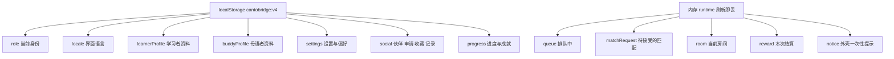

# 10 · 后端接口 v1 契约（属性汇总 → 接口清单）

> [09-frontend-logic-and-api.md](09-frontend-logic-and-api.md) 回答的是**结构问题**：前端怎么分层、后端提供哪些接口、两边怎么对接。本文回答的是**字段问题**：
>
> 1. 前端现在到底存了哪些属性（第 2 节，逐字段，可机器校验）
> 2. 每个接口的请求 / 响应字段叫什么、什么类型、什么必填（第 3、4 节）
> 3. 后端照着实现时要对齐哪些枚举、错误码与示例（第 3.5、3.6、4.9 节）
>
> **分工**：09 第 3.2 节是「有哪些接口」的唯一真源（路径级）；本文第 4 节是「接口里有哪些字段」的唯一真源（字段级）。两边必须一一对应，`frontend/tools/check-api.mjs` 会自动拦截任何一边多一条或少一条。
>
> **v1 的范围**：只写前端 MVP 现在就真的需要的东西，不发明接口。前端没有用到的能力（推送、分页游标、多设备）只在 07 里提为待确认项。

## 1. 这份文档解决什么

| 问题 | 答案在哪 | 谁最需要 |
| --- | --- | --- |
| 前端存了哪些属性、刷新之后还在不在 | 第 2 节 | 后端建模、前端联调 |
| 属性 ↔ 接口字段的命名怎么对应 | 第 3.4 节 | 后端 |
| 成功后返回什么、失败后返回什么 | 第 3.1、3.5 节 | 后端 |
| 每个接口的请求 / 响应字段 | 第 4.1 ~ 4.8 节 | 后端 + 前端 |
| 完整 JSON 长什么样（可当 mock 用） | 第 4.9 节 | 后端 + 前端 |
| mock 实现里的方法对应哪个接口 | 第 4.10 节 | 前端 |
| 哪些字段是前端自己算的、不用后端给 | 第 2.11 节 | 后端（省事） |

**读法**：后端只看第 3、4 节就能开工；第 2 节是「为什么是这些字段」的依据，字段级真源在第 2.10 节。

## 2. 属性汇总：前端现在到底存了什么

### 2.1 一页看完

前端的属性分成两半：**持久化**（刷新还在，写在浏览器 localStorage 的 `cantobridge:v4` 里）与**内存态**（刷新即丢，兜底矩阵接管）。v4 用于落实「账号按设备现场长出来」：存档升级不再把同一台手机变成新账号（设备 id 单独存 `cantobridge:device`，不进带版本闸门的存档）。

存档带一个 `version` 字段（当前 `4`）：**只认同版本存档**，版本对不上就整份作废、回到出厂状态。改了资料模型或出厂默认值就必须 +1，否则旧存档里上一版的出厂值会把新默认盖回去（v1 → v2 为「两份资料的出厂值全部清空」，v3 → v4 为「账号按设备现场长出来、前端出厂全空」）。



判断标准（与 09 第 2.7 节一致）：**刷新后还应该存在的 → 持久化；只服务当前会话 → 内存；只服务当前组件 → 组件内 state，不进 store。**

### 2.2 账号与身份

| 字段 | 类型 | 取值 | 默认 | 说明 |
| --- | --- | --- | --- | --- |
| `role` | enum | learner、buddy | learner | 当前身份，唯一真源；切换身份不清空另一份资料 |
| `locale` | enum | zh-Hans、zh-Hant、en | zh-Hans | 界面语言；粤语是**内容语言**不是界面语言 |

### 2.3 learnerProfile（学习者资料）

**出厂不预选任何一项**（除 `userId`）：注册问卷一进来每题都是空的，用户自己选。

| 字段 | 类型 | 取值 | 默认 | 说明 |
| --- | --- | --- | --- | --- |
| `userId` | string | —— | learner-u-ab12cd34 | **资料 id**，由账号派生（`learner-<accountId>`，见 4.1.1）；一个账号两份资料各一个 id |
| `nativeLanguage` | string 或 null | mandarin、english、other（兼容旧数据）或自定义语言名称 | null（未选） | 母语，单选；自定义名称去除首尾空白后为 1–10 个 Unicode 码点，不含控制字符，非法输入返回 400。用于匹配与教学提示 |
| `cantoneseLevel` | enum 或 null | beginner、elementary、intermediate、advanced | null（未选） | 粤语水平；决定话题卡难度（缺省时话题卡按 beginner） |
| `learningGoal` | enum 或 null | daily_conversation、make_local_friends、university_life、workplace_cantonese、hong_kong_culture | null（未选） | 学习目标 |
| `identity` | enum 或 null | university_student、exchange_student、working_professional、new_to_hong_kong | null（未选） | 身份标签 |
| `interests` | string[] | INTERESTS 预设值或 1–10 字符自定义文本 | `[]` | 兴趣标签，上限 5（`MAX_INTERESTS`）。**仍然参与匹配度**，但只在资料页维护，匹配页不再问一遍 |
| `onboarded` | boolean | true、false | false | 资料是否填过；路由守卫用它决定要不要补资料。**出厂是 false**：一台没注册过的设备要先走完 onboarding，对面才看得到一个完整的人 |

### 2.4 buddyProfile（母语者资料）

**同样出厂不预选**：第一次切到母语者身份时从空白开始填。

| 字段 | 类型 | 取值 | 默认 | 说明 |
| --- | --- | --- | --- | --- |
| `userId` | string | —— | buddy-u-ab12cd34 | 与学习者资料**是同一个账号的另一个身份**（`buddy-<accountId>`） |
| `languagesSpoken` | string[] | yue、mandarin、english | `[]` | 会说哪些语言，yue 是成为母语者的前提 |
| `identity` | enum 或 null | 同 IDENTITIES | null（未选） | 身份标签 |
| `interests` | string[] | INTERESTS 预设值或 1–10 字符自定义文本 | `[]` | 兴趣标签，与学习者的兴趣用同一套词表 |
| `preferredTopics` | string[] | BUDDY_TOPICS 的子集 | `[]` | 想聊的话题，匹配度的另一半权重 |
| `wantToLearn` | string[] 可为空 | NATIVE_LANGUAGES 的子集（不含 yue） | [] | **可选的回礼**「我也想练 X」。只进排序权重（见 2.11 的 `matchRank`），不进筛选：空数组一样能匹配。取值不含粤语——回礼不能是粤语，否则「交换」就退化成单向教学 |
| `onboarded` | boolean | true、false | false | 首次切到母语者身份时才补资料 |

> 两份资料**分开存、互不覆盖**：`PUT /api/me/profile/learner` 与 `PUT /api/me/profile/buddy` 是两个接口，后端也要分开存，否则「切身份」就会丢一边的数据。

### 2.5 settings（设置）

拆成两组：**要跟服务端同步的**（因为服务端要按它裁剪下发内容）与**前端本地的**（纯演示 / 体验开关）。

| 字段 | 类型 | 默认 | 分组 | 说明 |
| --- | --- | --- | --- | --- |
| `anonymous` | boolean | false | 服务端同步 | 匿名模式；新账号默认关闭，只在「我的 → 设置」主动切换；服务端据此裁剪身份字段 |
| `leaderboardVisible` | boolean | true | 服务端同步 | 关掉后排行榜里只显示「匿名伙伴」 |
| `visibility.interests` | boolean | true | 服务端同步 | 公开兴趣标签 |
| `visibility.level` | boolean | true | 服务端同步 | 公开粤语水平 |
| `visibility.identity` | boolean | true | 服务端同步 | 公开身份标签 |
| `matchCriteria` | string[] 或 null | null | 服务端同步 | 自定义匹配条件；null = 按资料里的兴趣找（**现在只有这一种情况**：匹配页不再让用户勾选兴趣，字段与接口保留给后续的筛选需求） |
| `signalMode` | enum | sim | 前端本地 | 信令档位：sim、local、remote（09 第 4.1 节的三个档位） |
| `mockDelayMs` | int | 400 | 前端本地 | mock 层的人为延迟，现场演示用 |
| `cardLevelOverride` | enum 或 null | null | 前端本地 | 强制话题卡难度，`/dev/mock` 现场调 |
| `autoMatch` | boolean | false | 前端本地 | 自动匹配成功（跳过等待），救场用 |
| `backgroundMatch` | boolean | true | 前端本地 | 离开 `/match` 后排队是否继续 |
| `matchAcceptSeconds` | int | 10 | 前端本地 | `MatchAcceptToast` 倒计时上限（秒）；服务端下发 `expiresAt` 后以服务端为准 |
| `theme` | enum | mint | 前端本地 | 配色主题：mint、warm |

> 前端本地的 7 项**不需要后端接口**：它们只影响本地渲染与 demo 时序。真要做服务端统一体验，也应该是随会话下发（如 `expiresAt`），而不是让用户设置。

### 2.6 social（社交）

四张表：伙伴、申请、收藏、记录。其中伙伴关系是**双向**的——「发出的申请」不等于「已经是伙伴」。

| 字段 | 类型 | 说明 | 元素结构 |
| --- | --- | --- | --- |
| `buddies` | array | 已经**互相接受**的伙伴 | `peerId`、`label`、`since` |
| `buddyRequests` | array | 待确认的申请，`direction` 区分收到 / 发出 | `requestId`、`peerId`、`label`、`direction`、`status`、`roomId`、`createdAt`、`respondedAt` |
| `savedPhrases` | array | 收藏的粤语表达 | `cantonese`、`mandarin`、`savedAt` |
| `history` | array | 通话记录；**不存**「是否已是伙伴」的布尔值，一律由上面两张表推导 | `sessionId`、`peerId`、`peerLabel`、`role`、`startedAt`、`durationSec`、`cardsUsed`、`topics` |

`direction` 只有两个取值：`incoming`（收到的）与 `outgoing`（我发出的）。`status` 在 v1 里只出现 `pending`：申请被接受或拒绝后**直接从表里移除**，不留历史状态。

### 2.7 progress（进度与成就）

| 字段 | 类型 | 默认 | 说明 |
| --- | --- | --- | --- |
| `xp` | int | 360 | 累计积分；结算时 + 每分钟 6 点 + 每张卡 5 点 |
| `streakDays` | int | 3 | 连续练习天数 |
| `totalMinutes` | int | 46 | 累计练习分钟 |
| `conversations` | int | 2 | 完成的对话次数 |
| `peopleHelped` | int | 0 | 母语者视角：和多少位学习者聊过 |
| `distinctTopics` | int | 6 | 聊过的不同话题数 |
| `practiceMinutesThisWeek` | int | 46 | 本周练习分钟，榜单用 |
| `topicsSeen` | string[] | anime、food、university、travel、daily_life、movies | 聊过的话题 id 列表，`distinctTopics` 由它推导 |

### 2.8 runtime（内存态，刷新即丢）

| 字段 | 类型 | 元素结构 | 谁写 | 谁读 |
| --- | --- | --- | --- | --- |
| `queue` | object 或 null | `joinedAt`、`anonymous` | 入队 / 取消匹配 | `MatchWaitingPanel` |
| `matchRequest` | object 或 null | `roomId`、`peer`、`reason`、`expiresAt`、`createdAt` | 匹配成功（`match:matched`） | `MatchAcceptToast` |
| `matchPeers` | array 或 null | 候选人公开视图（见 4.4 节） | 匹配频道推送 `queue:updated` / `match:taken` | `MatchPage` 的候选人列表 |
| `room` | object 或 null | `roomId`、`peer`、`role`、`startedAt`、`status` | 成房 / 状态机 | `ChatRoomPage` |
| `reward` | object 或 null | 见第 4.9 节的 `rewardSummary` | 结算 | `RewardCard` |
| `notice` | object 或 null | `kind` 等 | 外壳一次性提示 | `AppShell` |
| `onboarding` | object 或 null | `role`、`learnerProfile`、`buddyProfile` | 进入 onboarding 三页时立还原点 | 退出 onboarding 的 `store.cancelOnboarding()` |

**这 7 项不进后端契约**：它们是本地会话状态。后端只提供「成房 / 结算」的结果，房间与倒计时的生命周期由前端持有（真实实现里由服务端事件驱动，见 07 的 Q-G11）。

`matchPeers` 出厂是 `null` 而不是 `[]`：`null` 表示**还没收到过匹配频道的推送**，页面据此回落到自己从 REST 拉的那份；断线时列表不会凭空变空（见 09 第 3.3 节）。

### 2.9 属性归属：谁写、谁读、持久化到哪

| 归属 | 属性 | 谁可以写 |
| --- | --- | --- |
| 服务端权威 | `role`、两份资料的 `userId`、`progress.*`、`social.*`、`settings` 里的服务端同步项 | 只能通过接口写；前端本地只做缓存 |
| 用户偏好 | `settings.matchCriteria`、`settings.theme`、`locale` | 用户在界面里改，前端持久化并同步给后端 |
| 演示开关 | `settings.signalMode`、`mockDelayMs`、`cardLevelOverride`、`autoMatch`、`backgroundMatch`、`matchAcceptSeconds` | 只在 `/dev/mock` 与「我的」页改，不进后端 |
| 派生缓存 | 第 2.11 节的字段 | 没人写，每次算 |

### 2.10 属性字典（机器校验，字段级真源）

下表**逐字段列出前端现在真实存在的属性**，由 `tools/check-api.mjs` 与 `src/app/store.js` 的默认值双向比对：少一行、多一行、缺类型都会让 `npm run check` 失败。

| 属性字段 | 类型 | 存储 | 写入方 | 读取方 | 匿名时 | 关联接口 |
| --- | --- | --- | --- | --- | --- | --- |
| `role` | enum(learner,buddy) | localStorage | `setRole()`、session | `HomePage`、`MatchPage`、`AppShell` | —— | `/api/auth/session` |
| `locale` | enum(zh-Hans,zh-Hant,en) | localStorage | `setLocale()` | 三语切换、`TopBar` | —— | `/api/me/settings` |
| `learnerProfile.avatarId` | enum(neutral,male,female,star,fox,jade,male-sage) | localStorage | 注册、编辑资料 | 个人页、匹配、房间 | 匿名返回 neutral | `/api/me/profile/learner` |
| `learnerProfile.frameId` | enum(none,milk-tea,pineapple,tram,aurora,orbit,sakura,pixel) | localStorage | 编辑资料、商城 | 个人页、匹配、房间、排行榜 | 匿名返回 none | `/api/me/profile/learner` |
| `learnerProfile.userId` | string | localStorage | session | 房间、记录、排行榜 | 不下发 | `/api/auth/session` |
| `learnerProfile.nativeLanguage` | string 或 null（预设语言或 1–10 字符自定义名称） | localStorage | 资料接口 | `ProfilePreviewCard`、等待列表 | 公开 | `/api/me/profile/learner` |
| `learnerProfile.cantoneseLevel` | enum(4 档) | localStorage | 资料接口 | 话题卡难度、等待列表 | 受 `settings.visibility.level` 控制 | `/api/me/profile/learner` |
| `learnerProfile.learningGoal` | enum(5 个目标) | localStorage | 资料接口 | 匹配度、等待列表 | 公开 | `/api/me/profile/learner` |
| `learnerProfile.identity` | enum(4 个身份) | localStorage | 资料接口 | 列表身份徽标 | 受 `settings.visibility.identity` 控制 | `/api/me/profile/learner` |
| `learnerProfile.interests` | string[] 上限 5 | localStorage | 资料接口 | 匹配度、话题卡选卡 | 受 `settings.visibility.interests` 控制 | `/api/me/profile/learner` |
| `learnerProfile.onboarded` | boolean | localStorage | 资料接口 | 路由守卫 | —— | `/api/me/profile/learner` |
| `buddyProfile.avatarId` | enum(neutral,male,female,star,fox,jade,male-sage) | localStorage | 注册、编辑资料 | 个人页、匹配、房间 | 匿名返回 neutral | `/api/me/profile/buddy` |
| `buddyProfile.frameId` | enum(none,milk-tea,pineapple,tram,aurora,orbit,sakura,pixel) | localStorage | 编辑资料、商城 | 个人页、匹配、房间、排行榜 | 匿名返回 none | `/api/me/profile/buddy` |
| `buddyProfile.userId` | string | localStorage | session | 房间、记录 | 不下发 | `/api/auth/session` |
| `buddyProfile.languagesSpoken` | string[] | localStorage | 资料接口 | 语言徽标 | 公开 | `/api/me/profile/buddy` |
| `buddyProfile.identity` | enum(4 个身份) | localStorage | 资料接口 | 列表身份徽标 | 受 `settings.visibility.identity` 控制 | `/api/me/profile/buddy` |
| `buddyProfile.interests` | string[] 上限 5 | localStorage | 资料接口 | 匹配度 | 受 `settings.visibility.interests` 控制 | `/api/me/profile/buddy` |
| `buddyProfile.preferredTopics` | string[] | localStorage | 资料接口 | 匹配度、等待列表 | 公开 | `/api/me/profile/buddy` |
| `buddyProfile.wantToLearn` | string[] 可为空 | localStorage | 资料接口 | 互补排序（`matchRank`）、「语言互补」徽标 | 公开 | `/api/me/profile/buddy` |
| `buddyProfile.onboarded` | boolean | localStorage | 资料接口 | 路由守卫 | —— | `/api/me/profile/buddy` |
| `settings.anonymous` | boolean | localStorage | 设置接口 | 全局展示名 | 服务端据此裁剪 | `/api/me/settings` |
| `settings.leaderboardVisible` | boolean | localStorage | 设置接口 | `LeaderboardList` | 显示为「匿名伙伴」 | `/api/me/settings` |
| `settings.visibility.interests` | boolean | localStorage | 设置接口 | 等待列表、预览 | 关闭即不下发兴趣 | `/api/me/settings` |
| `settings.visibility.level` | boolean | localStorage | 设置接口 | 等待列表、预览 | 关闭即不下发水平 | `/api/me/settings` |
| `settings.visibility.identity` | boolean | localStorage | 设置接口 | 等待列表、预览 | 关闭即不下发身份 | `/api/me/settings` |
| `settings.equippedTitleId` | 成就 id 或 null | localStorage 服务端同步 | 成就墙 | 个人页、匹配 | 只展示已解锁称号 | `/api/me/settings` |
| `settings.signalMode` | enum(sim,local,remote) | localStorage | `MockControlPanel` | 信令选择 | —— | —— |
| `settings.mockDelayMs` | int 毫秒 | localStorage | `MockControlPanel` | mock 层延迟 | —— | —— |
| `settings.cardLevelOverride` | enum(4 档) 或 null | localStorage | `MockControlPanel` | 话题卡取卡 | —— | —— |
| `settings.autoMatch` | boolean | localStorage | `MockControlPanel` | 后台匹配引擎 | —— | —— |
| `settings.backgroundMatch` | boolean | localStorage | `MockControlPanel` | 后台匹配引擎 | —— | —— |
| `settings.matchAcceptSeconds` | int 秒 | localStorage | `MockControlPanel` | `MatchAcceptToast` | —— | —— |
| `settings.matchCriteria` | string[] 或 null | localStorage | `MatchCriteriaEditor` | 等待面板条件摘要 | —— | `/api/match/criteria` |
| `settings.theme` | enum(mint,warm) | localStorage | `ThemeSwitch` | 全局配色变量 | —— | —— |
| `social.buddies` | array | localStorage | 接受申请 | `BuddyRequestList`、`HistoryPage` | 可能是「匿名伙伴」 | `/api/me/buddies` |
| `social.buddyRequests` | array | localStorage | 申请四动作 | `BuddyRequestList` | 同上 | `/api/me/buddy-requests` |
| `social.savedPhrases` | array | localStorage | 句型收藏 | `PhraseChips` | —— | `/api/me/saved-phrases` |
| `social.history` | array | localStorage | 结算 | `HistoryPage` | —— | `/api/me/history` |
| `progress.xp` | int | localStorage | 结算 | `HomePage`、`ProfilePage` | —— | `/api/me/progress` |
| `progress.streakDays` | int | localStorage | 结算 | `HomePage` | —— | `/api/me/progress` |
| `progress.totalMinutes` | int | localStorage | 结算 | `HomePage`、`ProfilePage` | —— | `/api/me/progress` |
| `progress.conversations` | int | localStorage | 结算 | 成就判定 | —— | `/api/me/progress` |
| `progress.peopleHelped` | int | localStorage | 结算（母语者） | 伙伴等级、成就 | —— | `/api/me/progress` |
| `progress.distinctTopics` | int | localStorage | 结算 | 成就判定 | —— | `/api/me/progress` |
| `progress.practiceMinutesThisWeek` | int | localStorage | 结算 | 排行榜 | —— | `/api/me/progress` |
| `progress.topicsSeen` | string[] | localStorage | 结算 | 成就判定 | —— | `/api/me/progress` |
| `progress.achievements` | string[] | localStorage | 结算 | 成就墙 `AchievementWall` | —— | `/api/me/progress` |
| `runtime.queue` | object 或 null | 内存 | 入队 / 取消匹配 | `MatchWaitingPanel` | 带匿名快照 | `/api/match/queue` |
| `runtime.matchRequest` | object 或 null | 内存 | 匹配成功事件 | `MatchAcceptToast` | 只用于当次弹窗 | `/api/match/requests/:requestId/accept` |
| `runtime.matchPeers` | array 或 null | 内存 | 匹配频道推送 | `MatchPage` 的候选人列表 | **`null` = 还没收到过推送**，页面据此回落到自己从 REST 拉的那份 | `/ws/match` |
| `runtime.room` | object 或 null | 内存 | 成房 | `ChatRoomPage` | —— | `/api/rooms/:roomId` |
| `runtime.reward` | object 或 null | 内存 | 结算 | `RewardCard` | —— | `/api/rooms/:roomId/end` |
| `runtime.notice` | object 或 null | 内存 | 外壳一次性提示 | `AppShell` | —— | —— |
| `runtime.onboarding` | object 或 null | 内存 | 进入 onboarding 三页时立还原点 | 退出 onboarding 时按它还原角色与两份资料 | —— | —— |

### 2.11 派生字段（不是属性，别存）

这些字段**没有存储、没有接口**，每次由纯函数算出来。后端不需要下发它们，前端也不该把它们写进存档——否则就会出现「记录说已保存、伙伴表里却没有」这类脱节。

| 派生字段 | 怎么算 | 用在哪 |
| --- | --- | --- |
| `matchScore` | `matchScore()`：共同标签占较小标签集（上限 4）的比例，映射到 40 ~ 95 | 等待列表的匹配度百分比 |
| `matchedTags` | `sharedTags()`：我关注的话题 ∩ 对方的话题 | 预览页「你们都喜欢」 |
| `complementBoost` / `complementLanguage` | `complementBoost()`：`wantToLearn` ∩ 对方的母语命中返回 `COMPLEMENT_BOOST = 8`，否则 0；`complementLanguage()` 返回命中的那门语言（给徽标文案用） | 等待列表与推荐块的「语言互补」徽标 |
| `matchRank` | `matchRank()`：`matchScore` + `complementBoost`，即候选人排序键 | 母语者挑人、首页推荐块（**只排序，不筛选**） |
| `intent` | `intentForRole()`：身份 buddy → teach、learner → learn。**当前用户与对端都用它**（对端按对端的 `role`） | 匹配页顶部「学粤语 / 教粤语」标签、等待列表与资料预览的标签、房间头部「房主 · 教粤语 / 学粤语」徽标（**自动带上，不落库、不可自选**） |
| `buddyRelation` | `buddyRelation()`：由 `buddies` + `buddyRequests` 推导出 buddy、pending-out、pending-in、none 四态 | 记录页、个人页、结算页共用 |
| 展示名 | `peerDisplayName()`：匿名时一律「匿名伙伴」，不信任后端是否已裁剪 | 所有公开位置 |
| 可见标签 | `visibleTags()`：按 `visibility` 过滤兴趣与话题 | 等待列表、资料预览 |
| `xpEarned` | `xpFor()`：每分钟 6 点 + 每张卡 5 点 | 结算页 +XP |
| `buddyLevel` | `buddyLevel()`：按 `peopleHelped` 与 `totalMinutes` 分 newcomer、helper、guide、ambassador | 「我的」页母语者等级 |
| 成就解锁 | `unlockedAchievements()` / `newlyUnlocked()`：按规则判定，不落库 | `AchievementWall`、结算动效 |
| 剩余秒数 | `acceptCountdown()`：由 `expiresAt` 反推，向上取整 | `MatchAcceptToast` 倒计时 |
| `durationText` | `formatDuration()`：不足一分钟与按分钟两种文案 | 房间计时、记录列表 |
## 3. 通用约定 v1

### 3.1 信封与状态码

所有接口都在 `/api/` 之下，返回**统一信封**：

```json
{ "ok": true, "data": {} }
```

```json
{ "ok": false, "error": { "code": "room_taken", "message": "room already claimed" } }
```

| 状态码 | 什么时候用 | 前端表现 |
| --- | --- | --- |
| 200 | 成功（含 PUT / DELETE） | 正常渲染 |
| 201 | 成功且新建了资源（成房、发申请） | 正常渲染 |
| 400 | 参数不合法（枚举越界、兴趣超过 5 个） | 在表单上就地提示，不弹红页 |
| 401 | 未登录或令牌失效 | 清令牌回落地页，保留本地资料 |
| 403 | 身份不符（学习者调了只有母语者能调的接口） | 提示「当前身份不能做这件事」 |
| 404 | 资源不存在（候选人、房间、申请） | 空态 + 出路 |
| 405 | 请求方法与路径不匹配（例如对只读接口发 POST） | 提示「这个操作不支持」，并给出返回首页的按钮 |
| 409 | 冲突（房间已被别人占了、重复入队、已经是伙伴） | 按错误码分别处理，见 3.5 |
| 410 | 已过期（等待记录、匹配请求） | 提示 + 一键重排 |
| 429 | 限流 | 静默退避重试 2 次，仍失败转 `ErrorState` |
| 5xx | 服务端错误 | 结算类用本地估算值 + `FallbackBanner` |

**前端只认 `error.code`**：`message` 只用来打日志，界面文案一律走语言包，不直接显示服务端英文。

### 3.2 鉴权

| 项 | 约定 |
| --- | --- |
| 拿到令牌 | `POST /api/auth/session` 返回 `token` 与 `expiresAt` |
| 带上令牌 | 请求头 `Authorization: Bearer <token>` |
| 令牌失效 | 返回 401 `not_authorized`；前端清空令牌与内存状态，回落地页 |
| 续期 | `POST /api/auth/refresh`（APK 路线必需，Web 端可只做长有效期令牌） |
| 房间内 | 信令连接沿用同一个 `token`（放在握手 query 或首帧，由后端定，见 07） |

公开接口只有三个：`/api/tags`、`/api/auth/session`、`/api/app/version-policy`。其余全部要令牌。

### 3.3 幂等

所有**写**接口都带客户端生成的 `requestId`（uuid 或时间戳 + 随机串），服务端对同一个 `requestId` 去重：

- 重复提交返回**第一次的结果**，而不是报错——弱网重试不能让用户看到「房间号变了」。
- 特别是成房：同一次匹配重试两次，只能产生一间房。这是「匹配成功后房间从公共列表关闭」的底层保证，不能靠前端把列表项删掉来假装。

读接口（`GET`）天然幂等，不需要 `requestId`。

### 3.4 命名、时间与单位

| 项 | 约定 | 例子 |
| --- | --- | --- |
| 字段命名 | 小驼峰（camelCase） | `learnerProfile`、`queueEntryId` |
| 枚举取值 | 小写下划线或单词 | `hong_kong_food`、`beginner`、`incoming` |
| 时间戳 | ISO 8601 字符串，**带时区偏移** | `2026-09-23T21:10:00+08:00` |
| 时长 | 整数秒，字段名以 `Sec` 结尾 | `durationSec`、`matchAcceptSeconds` |
| 倒计时截止 | ISO 8601 绝对时间，字段名以 `expiresAt` 结尾 | `expiresAt` |
| id 前缀 | `q-` 排队、`r-` 房间、`req-` 申请、`s-` 会话 | `r-demo-77581` |

前端属性与线上字段名的对应关系（**唯一一处对照，后端按右列收字段**）：

| 前端属性 | 接口字段 | 说明 |
| --- | --- | --- |
| `locale` | `interfaceLanguage` | 同一个东西的两个名字；线上字段名用 `interfaceLanguage` |
| `settings.anonymous` | `anonymous` | 请求与响应同名 |
| `settings.visibility` | `visibility` | 四个布尔子字段：interests、level、identity、nativeLanguage（未提供时默认公开） |
| `settings.leaderboardVisible` | `leaderboardVisible` | 同名 |
| `settings.matchCriteria` | `criteria` | 请求体里叫 `topics`（字符串数组），响应里叫 `criteria` |
| `settings.matchAcceptSeconds` | `expiresAt` | 前端只定倒计时上限；服务端下发 `expiresAt` 后以服务端为准 |
| `social.history` | `entries` | 列表类接口一律用 `entries` |
| `social.buddies` | `buddies` | 响应是一个对象，伙伴数组在 `buddies` 里 |
| `social.buddyRequests` | `requests` | 响应是一个对象，申请数组在 `requests` 里 |
| `runtime.room` | `room`、`peer`、`status` | 房间元信息拆成三个字段返回 |
| `runtime.matchPeers` | `entries` | 匹配频道 `queue:updated` 的推送载荷是 `{ type, entries }`，取 `entries` **整份替换** |
| `runtime.matchRequest` | `requestId`、`roomId`、`peer`、`expiresAt` | `match:matched` 的推送载荷；**`requestId` 为 `null` 表示对方已经把房开好**，直接进房、不弹接受框 |
| `progress.*` | 同名扁平字段 | `GET /api/me/progress` 直接返回扁平对象，不再包一层 |

**mock 与服务端的形状差异（接线时逐条适配，不要指望透传）**：第 4.10 节列出的 mock 方法返回的是**前端内部形状**，和线上字段并不总是一一对应。`src/services/index.js` 的 HTTP 分支必须按下表转换，否则列表页会因为没有 `.entries` 直接渲染空态。

| mock 现在返回 | 线上返回 | 服务层要做什么 |
| --- | --- | --- |
| `listWaitingLearners()` 裸数组 | `entries` 数组 | 取 `.entries` |
| `getHistory()` 裸数组 | `entries` 数组 | 取 `.entries` |
| `getLeaderboard()` 裸数组 | `entries` 数组 | 取 `.entries` |
| `listBuddies()` 裸数组 | `buddies` 数组 | 取 `.buddies` |
| `listBuddyRequests()` 裸数组 | `requests` 数组 | 取 `.requests` |
| `getRoom()` 只返回 `room` | `room`、`peer`、`status`、`startedAt` 四个平铺字段 | 摊平，别把整份响应塞进 `room` |
| `getMe()` 返回两份资料 + `settings` | 还带 `userId` 与 `progress` | 直接用线上的值，页面不必再单独调 `GET /api/me/progress` |
| `signIn(role)` 只返回 `userId` 与 `role` | 还带 `token`、`expiresAt` | 由服务层保存令牌；401 时清掉并回落地页 |
| `getCandidate()` 里叫 `reason` | `reasons` | 改名（已在 07 的 Q-G20 记录） |

### 3.5 错误码

| 错误码 | HTTP | 触发场景 | 前端表现 |
| --- | --- | --- | --- |
| `bad_request` | 400 | 字段缺失、枚举越界、兴趣超过 5 个 | 表单就地提示 |
| `not_authorized` | 401 | 没令牌、令牌过期 | 清令牌回落地页 |
| `forbidden` | 403 | 身份与接口不匹配 | 提示并给出返回首页的按钮 |
| `not_found` | 404 | 候选人 / 房间 / 申请不存在 | 空态 + 出路 |
| `method_not_allowed` | 405 | 请求方法与路径不匹配 | 提示「这个操作不支持」+ 返回首页 |
| `room_gone` | 404 | 房间已结束或刷新后丢失 | 回匹配大厅 + 一次性提示 |
| `room_taken` | 409 | 同一间房被第二个人创建 | 预览页换空态「这位伙伴已经开始聊天了」，自动刷新列表 |
| `already_queued` | 409 | 重复入队 | 直接进等待面板，不报错 |
| `already_buddy` | 409 | 对已经是伙伴的人再发申请 | 静默忽略，界面直接显示「已是伙伴」 |
| `queue_expired` | 410 | 等待记录过期 | 提示「你的等待已过期」+ 一键重新排队 |
| `match_request_expired` | 410 | 匹配请求被接受或超时 | 收起弹窗，人留在队列等下一次，不弹红页 |
| `rate_limited` | 429 | 触发限流 | 退避重试 2 次 |
| `turn_unavailable` | 503 | 拿不到 TURN 凭证 | 语音降级到本地档位，再退到模拟通话，界面不变 |
| `internal` | 500 | 服务端异常 | 结算类用本地估算值 + `FallbackBanner` |

**总原则**：演示路径上任何一个失败都要有出路，宁可给「降级数据 + 说明」，也不要给死胡同。

### 3.6 枚举与词表（后端要对齐的取值）

下表是**唯一真源**，由校验脚本与 `src/data/tags.js` 双向比对：少一个取值、多一个取值都会让 `npm run check` 失败。

| 词表 | 取值 | 用在哪 |
| --- | --- | --- |
| `ROLES` | `learner`、`buddy` | 身份、榜单分榜 |
| `LEVELS` | `beginner`、`elementary`、`intermediate`、`advanced` | 话题卡难度、水平标签 |
| `NATIVE_LANGUAGES` | `mandarin`、`english`、`other` | 学习者母语 |
| `IDENTITIES` | `university_student`、`exchange_student`、`working_professional`、`new_to_hong_kong` | 身份标签（两种身份共用） |
| `INTERESTS` | `movies`、`anime`、`gaming`、`music`、`food`、`travel`、`hiking`、`basketball`、`football`、`badminton`、`photography`、`technology`、`hong_kong_culture` | 兴趣标签（两种身份共用），单个用户最多 5 个 |
| `LEARNING_GOALS` | `daily_conversation`、`make_local_friends`、`university_life`、`workplace_cantonese`、`hong_kong_culture` | 学习者目标 |
| `BUDDY_TOPICS` | `hong_kong_food`、`movies`、`gaming`、`university_life`、`travel`、`local_culture`、`sports` | 母语者想聊的话题，也是「宽松匹配条件」的候选池 |
| `MATCH_INTENTS` | `teach`、`learn` | 教 / 学 两枚**身份标签**：由身份派生（`intentForRole`），不可自选、不进设置；取值只用于文案与顺序 |
| `LEARNER_FEEDBACK_TAGS` | `friendly`、`patient`、`easy_to_understand`、`helpful` | 学习者给母语者的反馈 |
| `BUDDY_FEEDBACK_TAGS` | `active_learner`、`friendly`、`willing_to_speak_cantonese`、`great_conversation` | 母语者给学习者的反馈 |

另外两个不在表里、但要一致的取值：

- `languagesSpoken` 的元素：`yue`、`mandarin`、`english`（`yue` 是成为母语者的前提）。
- `direction` 的元素：`incoming`、`outgoing`；`status` 在 v1 只有 `pending`。

### 3.7 版本与路径

- 所有接口都在 `/api/` 之下；接入正式环境时在 `/api/` 与资源名之间插一段版本号（先按 `/api/` 实现，加 `v1` 是纯字符串改动），前端把前缀收在环境变量里，代码里不散落。
- 信令走独立的 WebSocket 频道（第 5 节），**不复用** REST 端口。
- 演示环境固定 `https` 与 `wss`（`getUserMedia` 只在安全上下文可用）。

### 3.8 列表、裁剪与分页

| 项 | v1 约定 |
| --- | --- |
| 裁剪 | 匿名与可见范围由**服务端**裁剪；前端不应收到「已隐藏但照样下发」的字段 |
| 空列表 | 返回空数组而不是 null，前端据此渲染空态 |
| 分页 | v1 只给 `limit`（默认 20，最大 50）；游标分页留到 v2，见 07 |
| 排序 | 等待列表与推荐候选按 `matchRank` 降序（= `matchScore` + 互补加成，见 2.11）；记录与排行榜按时间 / 名次降序 |

## 4. 接口清单 v1

> **口径**：09 第 3.2 节写的是「主要字段」的速览；**字段的确切名字、类型与必填以本节为准**（例如 09 写 `achievements[]`，v1 定名为 `unlocked`）。
>
> 本节的端点集合与 09 第 3.2 节**逐条一一对应**：多有、少有、重名都会被 `tools/check-api.mjs` 拦下来。每个端点写清六件事：鉴权、幂等、请求字段、响应字段、错误码、谁在用。

### 4.1 账号与鉴权

| 接口 | 方法 | 鉴权 | 幂等 | 请求字段 | 响应字段 | 错误码 |
| --- | --- | --- | --- | --- | --- | --- |
| `/api/auth/session` | POST | 否 | 是 | `role`、`deviceId`、`requestId` | `token`、`expiresAt`、`userId`、`role` | 400 `bad_request` |
| `/api/auth/login` | POST | 否 | 是 | `userId`、`credential`、`requestId` | `token`、`refreshToken`、`expiresAt`、`userId`、`role` | 401 `not_authorized` |
| `/api/auth/refresh` | POST | Bearer | 是 | `refreshToken`、`requestId` | `token`、`expiresAt` | 401 `not_authorized` |
| `/api/auth/logout` | POST | Bearer | 是 | `requestId` | `ok` | 401 `not_authorized` |

- `role` 必填，取值见 3.6 的 `ROLES`；demo 阶段不校验 `credential`。
- **`deviceId` 必填（1~64 字符），它是账号的钥匙**：服务端按它查账号——见过就复用、没见过就建一个
  （见 4.1.1）。前端把它存在 `localStorage` 的独立键 `cantobridge:device` 里，**不进带版本闸门的存档**
  （存档升级会整份作废，设备 id 跟着换就等于把用户换成另一个人）。
  不带它，两台设备会被认成同一个账号——「两台设备连不上」的根因就是这个。
- `refreshToken` 只有 APK 路线（见 08）需要，Web 端可以先返回同样的 `token`。
- 谁在用：落地页与 onboarding 入口调 session；`/dev/mock` 切身份也走它；登录页是后续版本的事。

#### 4.1.1 账号模型：一个账号，两份资料

| 概念 | 取值 | 说明 |
| --- | --- | --- |
| 账号 | `u-` + 8 位 base36 | `users` 表的一行；`deviceId` 是它的钥匙 |
| 资料 | `learner-<accountId>` / `buddy-<accountId>` | `profiles` 表的两行，同一个账号的人格分身 |

- **一个账号有 learner / buddy 两种身份**，各自一份资料、互不覆盖；切换身份不新建账号。
- 下发给前端的 `userId` 就是**资料 id**（`profileIdFor(accountId, role)` 的结果），不是账号 id。
  服务端与前端用同一条派生规则（`backend/src/store/seed.js` / `frontend/src/app/store.js`）。
- 出厂种子是**空的**：没有任何预置账号、预置队列、预置进度。谁注册就长出一个账号，
  「列表里只有真实注册的人」由此成立。

### 4.2 资料与设置

| 接口 | 方法 | 鉴权 | 幂等 | 请求字段 | 响应字段 | 错误码 |
| --- | --- | --- | --- | --- | --- | --- |
| `/api/me` | GET | Bearer | 是 | 无 | `userId`、`learnerProfile`、`buddyProfile`、`settings`、`progress` | 401 `not_authorized` |
| `/api/me/profile/learner` | PUT | Bearer | 是 | `nativeLanguage`、`cantoneseLevel`、`learningGoal`、`identity`、`interests`、`requestId` | `learnerProfile` | 400 `bad_request` |
| `/api/me/profile/buddy` | PUT | Bearer | 是 | `languagesSpoken`、`identity`、`interests`、`preferredTopics`、`wantToLearn`、`requestId` | `buddyProfile` | 400 `bad_request` |
| `/api/me/settings` | PUT | Bearer | 是 | `interfaceLanguage`、`anonymous`、`visibility`、`leaderboardVisible`、`requestId` | `settings` | 400、401 |

- `PUT` 是**部分更新**（只带要改的字段），响应回**整份**资料 / 设置，前端直接用返回值覆盖本地缓存。
- `GET /api/me` 一次拿齐，避免首屏三次往返；`progress` 是摘要，明细走 `/api/me/progress`。
- `interests` 支持预设 INTERESTS 值和自定义文本，两种身份均适用。自定义文本去除首尾空白后为 1–10 个 Unicode 码点，不允许控制字符；预设值保留原 ID。重复值合并，合计超过 5 个返回 400 `bad_request`。前端超长时实时提示并禁止添加，空白和重复标签同样提示；自定义文本按纯文本展示。
- 谁在用：`/onboarding/profile`、`/onboarding/privacy`（只改 `visibility`）、`/me`（匿名开关的唯一入口）、`/home`。

### 4.3 字典

用户名扩展：两种资料接口均接受可选 `displayName`（账号共用的显示用户名）。去除首尾空白后为 2–16 个 Unicode 码点，不允许控制字符；非法输入返回 400。省略时保留原名，允许重名，`userId` 保持原有标识。更新后两份资料、排队展示和排行榜使用新名字；匿名响应继续隐藏名字。资料响应可带 `displayName`。


| 接口 | 方法 | 鉴权 | 幂等 | 请求字段 | 响应字段 | 错误码 |
| --- | --- | --- | --- | --- | --- | --- |
| `/api/tags` | GET | 否 | 是 | `kind` | `identities`、`interests`、`goals`、`buddyTopics`、`levels`、`nativeLanguages` | 400 `bad_request` |

- `kind` 可选（identities、interests、goals、buddyTopics、levels、nativeLanguages）；不带就是一次全给。
- 词表内容与第 3.6 节完全一致；前端也会本地兜底一份，字典接口挂了不影响演示。
- 谁在用：`/onboarding/profile`（标签选择器）、`/match`（匹配条件编辑器）。

### 4.4 匹配

| 接口 | 方法 | 鉴权 | 幂等 | 请求字段 | 响应字段 | 错误码 |
| --- | --- | --- | --- | --- | --- | --- |
| `/api/match/queue` | POST | Bearer | 是 | `learnerProfileSnapshot`、`anonymous`、`criteria`、`requestId` | `queueEntryId`、`joinedAt` | 409 `already_queued` |
| `/api/match/queue` | DELETE | Bearer | 是 | `queueEntryId`、`requestId` | `ok` | 410 `queue_expired` |
| `/api/match/queue` | GET | Bearer | 是 | `interests`、`limit` | `entries` | 401 `not_authorized` |
| `/api/match/recommendations` | GET | Bearer | 是 | `interests`、`limit` | `entries` | 401 `not_authorized` |
| `/api/match/criteria` | PUT | Bearer | 是 | `topics`、`requestId` | `ok`、`criteria` | 400 `bad_request` |
| `/api/match/candidates/:learnerId` | GET | Bearer | 是 | 无 | `candidate`、`matchedTags`、`matchScore`、`reasons`、`roomAvailable` | 404 `not_found` |
| `/api/match/requests/:requestId/accept` | POST | Bearer | 是 | `requestId` | `roomId`、`peer`、`expiresAt` | 409 `room_taken`、410 `match_request_expired` |
| `/api/match/requests/:requestId/decline` | POST | Bearer | 是 | `requestId`、`reason` | `ok` | 410 `match_request_expired` |
| `/api/rooms` | POST | Bearer | 是 | `learnerId` 或 `buddyId`、`requestId` | `roomId`、`peer`、`expiresAt` | 409 `room_taken` |

- **成房必须原子**：`accept` 与 `POST /api/rooms` 都可能成房，同一间房只能成功一次，第二次必须 409 `room_taken`。前端拿到 409 就把预览页换成空态，不假装成功。
- **取消等待要连坐**：`DELETE /api/match/queue` 必须在同一个动作里作废**还没接受**的匹配请求，否则对面会一直干等到倒计时结束（见 07 的 Q-G15）。
- **不接受 ≠ 退出匹配**：`decline` 之后人留在队列里，等待计时不清零；彻底退出只有 `DELETE /api/match/queue` 一条路。
- `PUT /api/match/criteria` 传 `topics` 为 `null` 或空数组 = 清掉自定义条件，回到按资料兴趣找；「随便聊」就是全部主题都勾上，不发明新语义。
- **触发方是双向的**：`GET /api/match/queue` 给母语者挑人，`GET /api/match/recommendations` 给学习者在首页挑人；两边排的是同一批候选、同一套排序键（`matchRank`）。语言互补**只影响顺序，不影响谁出现在列表里**——小规模冷启动下，筛掉人就等于匹配不到人。
- **推荐 ≠ 预约**：`/api/match/recommendations` 只读候选，点「直接聊」才调 `POST /api/rooms`（请求字段传 `buddyId`）；成房必须是原子的，与母语者挑人共用一条 409 `room_taken`。
- `reasons` 是理由数组（共同标签等），**v1 定名 `reasons`**；现有 mock 层把它叫 `reason`，接真实接口时由服务层统一改名（一处改动，见 07 的 Q-G20）。
- 谁在用：`/match`（开始卡片、等待面板、浏览列表）、`/match/:learnerId`（预览与开始通话）、全局的 `MatchAcceptToast`（接受 / 不接受）。

### 4.5 房间与话题卡

| 接口 | 方法 | 鉴权 | 幂等 | 请求字段 | 响应字段 | 错误码 |
| --- | --- | --- | --- | --- | --- | --- |
| `/api/rooms/:roomId` | GET | Bearer | 是 | 无 | `room`、`peer`、`status`、`startedAt` | 404 `room_gone`、403 `forbidden` |
| `/api/rooms/:roomId/cards` | GET | Bearer | 是 | `level`、`interests`、`count`、`round`、`exclude` | `roomId`、`level`、`round`、`cards` | 404 `room_gone`、403 `forbidden` |
| `/api/rooms/:roomId/end` | POST | Bearer | 是 | `durationSec`、`cardsUsed`、`topics`、`requestId` | `durationSec`、`cardsUsed`、`xpEarned`、`unlocked`、`topics` | 404 `room_gone`、403 `forbidden` |
| `/api/rooms/:roomId/feedback` | POST | Bearer | 是 | `tags`、`skipped`、`requestId` | `ok` | 400 `bad_request`、403 `forbidden` |
| `/api/me/saved-phrases` | POST | Bearer | 是 | `cantonese`、`mandarin`、`phrase`、`roomId`、`requestId` | `savedPhrase` | 400 `bad_request` |

- 话题卡是 **Mock AI Service 的真实对应物**：后端先用本地卡池（472 张 = 13 个兴趣主题 × 4 档 × 8 张 + 7 个通用主题 × 4 档 × 2 张）+ 按 `level` 与 `interests` 选卡，接口形状与 AI 生成完全一样，只是 `cards` 的来源不同（见 07 的 Q-G21）。
- **发起人两种，接口一个**：母语者挑人传 `learnerId`（对方是等待中的学习者），学习者在首页点「直接聊」传 `buddyId`（对方是 `GET /api/match/recommendations` 里给出的 `peerId`）。服务端只需保证「同一个伙伴只能被摘走一次」，不需要区分是谁点的。
- `level` 缺省时用学习者的 `cantoneseLevel`；`count` 默认 8，因为 `TopicCardStack` 一次预取一叠。
- `interests` 缺省时**取双方各自在这间房里那个身份**的资料兴趣**交集**（母语者按 `peerRole` 取，发起人取另一边），并**只在兴趣主题里出卡**——不会冒出与双方兴趣无关的卡。**不是并集**：只有一方点过的主题一张都不出，交集为空时退到通用主题兜底。
- 选卡是**兴趣驱动 + 种子洗牌**：先按「兴趣命中 → 这一叠没看过 → 账号里已聊过的主题（`progress.topicsSeen`）往后挪 → 离本人档位近的优先」四层排序，再**按主题全局轮流发牌**（一圈每个主题发一张）；洗牌种子是 `房间号:round`，所以**同一间房的两侧拿到同一叠**、换一叠或换房就换一批卡。
- `round` 是「第几叠」（夹 0~64，默认 0）；`exclude` 传上一叠看过的卡 id（逗号分隔），换叠时带上它就能拿到与上一叠**零交集**的新一叠——「再来八张」走的就是这条路。
- 兴趣主题凑不满一叠时，先在兴趣主题内放宽难度（按离本人档位远近排序），**最后才**拿通用主题兜底。
- `end` 是**幂等**的：重复提交同一 `requestId` 返回同一份结算，避免弱网重试把 XP 加两次。
- `unlocked` 只含**本次新解锁**的成就 id（全量成就在 `/api/me/progress` 里）。
- 谁在用：`/room/:roomId`（房间、卡牌、收藏句型）、`/room/:roomId/summary`（结算、反馈）。

### 4.6 伙伴关系

| 接口 | 方法 | 鉴权 | 幂等 | 请求字段 | 响应字段 | 错误码 |
| --- | --- | --- | --- | --- | --- | --- |
| `/api/me/buddies` | GET | Bearer | 是 | 无 | `buddies` | 401 `not_authorized` |
| `/api/me/buddies/:peerId` | DELETE | Bearer | 是 | `requestId` | `ok` | 404 `not_found` |
| `/api/me/buddy-requests` | GET | Bearer | 是 | `direction`、`status` | `requests` | 401 `not_authorized` |
| `/api/me/buddy-requests` | POST | Bearer | 是 | `peerId`、`roomId`、`requestId` | `request`、`status` | 409 `already_buddy` |
| `/api/me/buddy-requests/:peerId/accept` | POST | Bearer | 是 | `requestId` | `buddy`、`request` | 404 `not_found` |
| `/api/me/buddy-requests/:peerId/decline` | POST | Bearer | 是 | `requestId` | `ok` | 404 `not_found` |
| `/api/me/buddy-requests/:peerId` | DELETE | Bearer | 是 | `requestId` | `ok` | 404 `not_found` |

- **发出申请不等于成为伙伴**：`POST /api/me/buddy-requests` 只写入一条 `pending` 的申请，响应里的 `status` 可能是 `pending`（已排队）、`buddy`（早就是了，幂等返回）、`accepted`（对方也申请过我，双方自动成为伙伴）。
- **双方都申请过 = 互相确认**，直接成为伙伴，不要再要求其中一方点接受。
- 接受与拒绝之后申请**直接从表里移除**（v1 的 `status` 只有 `pending`），不保留「已拒绝」记录，避免尴尬。
- 解除伙伴只删伙伴关系，通话记录、积分、成就全部保留。
- 谁在用：`/me` 的「我的伙伴」插槽、`/history`（每行的伙伴状态）、`/room/:roomId/summary`（发出申请）。

### 4.7 沉淀

| 接口 | 方法 | 鉴权 | 幂等 | 请求字段 | 响应字段 | 错误码 |
| --- | --- | --- | --- | --- | --- | --- |
| `/api/me/progress` | GET | Bearer | 是 | 无 | `xp`、`streakDays`、`totalMinutes`、`conversations`、`peopleHelped`、`distinctTopics`、`practiceMinutesThisWeek`、`achievements`、`buddyLevel` | 401 `not_authorized` |
| `/api/me/history` | GET | Bearer | 是 | `buddyOnly`、`limit` | `entries` | 401 `not_authorized` |
| `/api/leaderboard` | GET | Bearer | 是 | `period`、`role` | `entries` | 400 `bad_request` |

- `achievements` 是**已解锁成就 id 的全量列表**；未解锁的不下发，前端用第 3.6 节之外的成就表（见 4.9）展示灰态。
- `buddyLevel` 由服务端算（newcomer、helper、guide、ambassador），规则与前端纯函数一致，避免两边算出两个等级。
- 历史条目**不存**「是否已是伙伴」，伙伴状态一律由 4.6 的两张表推导（见 07 的 Q-G9）。
- `period` 取 weekly 或 monthly，`role` 取 learner 或 buddy；`anonymous` 为 true 的行用「匿名伙伴」占位。
- **榜单上只有真实注册的账号**：服务端按 `deviceId` 长出来的账号有多少个，榜上就最多有多少行
  （上限 20，见 `LEADERBOARD_LIMIT`）。出厂没有任何预置行——「谁注册了就看见谁」这句话对榜单同样成立。
- 谁在用：`/home`、`/me`、`/leaderboard`、`/history`。

### 4.7.1 积分钱包与主题商城

`xp` 为累计获得积分，不因兑换减少。钱包 `balance` 为可用余额，旧账号首次读取按 xp 初始化；`ownedThemes` 默认 mint/warm，`transactions` 记录收入与支出。双方同场基础奖励各一次：round(durationSec/60*6)+cardsUsed*5；输入时长上限 86400 秒，卡数上限 64。满 60 秒通话且对方提交非空评价时，被评价者获 10 分，每场每个评价者一次。仅房间参与者能结算和评价；重复请求不重复发奖。兑换按服务器商品价格扣余额，重复兑换不扣款，余额不足返回 400 bad_request，兑换永久解锁。当前商城开启临时测试价，暖橙、简约蓝、深夜黑和护眼绿均为 0 分；测试结束后可在前后端商品目录关闭 SHOP_TEST_PRICES 恢复正常价格。

| 接口 | 方法 | 认证 | 幂等 | 请求字段 | 响应字段 | 错误 |
| --- | --- | --- | --- | --- | --- | --- |
| `/api/me/shop` | GET | Bearer | 是 | 无 | `balance`、`ownedThemes`、`transactions`、`catalog` | 401 `not_authorized` |
| `/api/me/shop/redeem` | POST | Bearer | 是 | `itemId`、`requestId` | `balance`、`ownedThemes`、`transactions`、`catalog` | 400 `bad_request` |

### 4.8 基础设施

| 接口 | 方法 | 鉴权 | 幂等 | 请求字段 | 响应字段 | 错误码 |
| --- | --- | --- | --- | --- | --- | --- |
| `/api/rtc/ice-servers` | GET | Bearer | 是 | 无 | `iceServers`、`expiresAt` | 503 `turn_unavailable` |
| `/api/app/version-policy` | GET | 否 | 是 | `platform`、`version` | `minVersion`、`message`、`forceUpgrade` | 500 `internal` |

- `iceServers` 是 STUN 与 TURN 的数组，TURN 凭证要有有效期（`expiresAt`）；房间建立前拉一次。
- 拿不到 TURN 时返回 503 `turn_unavailable`，前端**降级而不是中断**：先试本地档位（同浏览器双标签页），再退到模拟通话，界面不变。
  **实现口径（2026-09-29）**：后端判 503 的条件是「连 STUN 都拿不到」，而不是「没有 TURN」——
  同 Wi-Fi 直连只需要 STUN，真按字面回 503 会把最重要的演示路径掐死。前端两条分支都要留着。
- `version-policy` 只给 APK 路线用（见 08），Web 端可以不调。
### 4.9 DTO 完整定义（可当 mock 用）

以下示例都是**合法 JSON**，由校验脚本 `JSON.parse` 逐个验证过；字段名与第 2.10 节的属性字典、第 3.6 节的词表严格一致。

**登录 / 一键进入**（`POST /api/auth/session`）——请求体是 `{ "role": "learner", "deviceId": "d-8f21c4ab" }`，响应如下：

```json
{
  "token": "demo-token-2f8c",
  "expiresAt": "2026-09-25T21:00:00+08:00",
  "userId": "learner-u-ab12cd34",
  "role": "learner"
}
```

> `deviceId` 第一次出现就**新建账号**，之后同一台设备（含刷新、换身份）都复用同一个账号。
> 两台设备 = 两个账号 = 互相能看见、也能互相选中。响应里的 `userId` 是**资料 id**（见 4.1.1）。

**一次拿齐账号**（`GET /api/me`）——下面是**注册并练过之后**的样子；刚注册的账号 `onboarded` 是 `false`、进度全零、社交三张表全空：

```json
{
  "userId": "learner-u-ab12cd34",
  "learnerProfile": {
    "userId": "learner-u-ab12cd34",
    "nativeLanguage": "english",
    "cantoneseLevel": "beginner",
    "learningGoal": "daily_conversation",
    "identity": "exchange_student",
    "interests": ["anime", "food"],
    "onboarded": true
  },
  "buddyProfile": {
    "userId": "buddy-u-ab12cd34",
    "languagesSpoken": ["yue", "mandarin", "english"],
    "identity": "university_student",
    "interests": ["movies", "gaming", "food"],
    "preferredTopics": ["hong_kong_food", "university_life"],
    "onboarded": false
  },
  "settings": {
    "interfaceLanguage": "zh-Hans",
    "anonymous": false,
    "leaderboardVisible": true,
    "visibility": { "interests": true, "level": true, "identity": true }
  },
  "progress": {
    "xp": 360,
    "streakDays": 3,
    "totalMinutes": 46,
    "conversations": 2,
    "peopleHelped": 0,
    "distinctTopics": 6,
    "practiceMinutesThisWeek": 46
  }
}
```

**标签字典**（`GET /api/tags`）：

```json
{
  "identities": ["university_student", "exchange_student", "working_professional", "new_to_hong_kong"],
  "interests": ["movies", "anime", "gaming", "music", "food", "travel", "hiking", "basketball", "football", "badminton", "photography", "technology", "hong_kong_culture"],
  "goals": ["daily_conversation", "make_local_friends", "university_life", "workplace_cantonese", "hong_kong_culture"],
  "buddyTopics": ["hong_kong_food", "movies", "gaming", "university_life", "travel", "local_culture", "sports"],
  "levels": ["beginner", "elementary", "intermediate", "advanced"],
  "nativeLanguages": ["mandarin", "english", "other"]
}
```

**入队结果**（`POST /api/match/queue`）：

```json
{
  "queueEntryId": "q-1758700000000",
  "joinedAt": "2026-09-23T20:55:00+08:00"
}
```

**等待者列表**（`GET /api/match/queue`，母语者视角）：

```json
{
  "entries": [
    {
      "peerId": "learner-u-ab12cd34",
      "anonymous": true,
      "displayName": "匿名伙伴",
      "nativeLanguage": "english",
      "cantoneseLevel": "beginner",
      "identity": "exchange_student",
      "interests": ["anime", "food"],
      "intent": "learn",
      "goal": "daily_conversation",
      "matchScore": 86,
      "matchedTags": ["anime", "food"],
      "joinedAt": "2026-09-23T20:55:00+08:00"
    }
  ]
}
```

**候选人预览**（`GET /api/match/candidates/:learnerId`）——注意匿名 + 关闭可见范围时，`identity` 与 `interests` 由**服务端**裁剪成 null 与空数组：

```json
{
  "candidate": {
    "peerId": "learner-u-9f3c1d7a",
    "anonymous": true,
    "displayName": "匿名伙伴",
    "nativeLanguage": "other",
    "cantoneseLevel": "beginner",
    "identity": null,
    "interests": [],
    "goal": "university_life",
    "joinedAt": "2026-09-23T21:01:00+08:00"
  },
  "matchedTags": ["travel"],
  "matchScore": 78,
  "reasons": ["travel"],
  "roomAvailable": true
}
```

**匹配成功事件**（信令 `match:matched` 的载荷，也是 `MatchAcceptToast` 读的东西）：

```json
{
  "requestId": "req-match-77581",
  "roomId": "r-demo-77581",
  "peer": { "peerId": "buddy-u-7c4e9a21", "displayName": "buddy-u-7c4e9a21", "anonymous": false },
  "expiresAt": "2026-09-23T21:05:10+08:00"
}
```

**房间元信息**（`GET /api/rooms/:roomId`）：

```json
{
  "room": { "roomId": "r-demo-77581", "status": "live", "role": "learner", "startedAt": "2026-09-23T21:00:00+08:00" },
  "peer": { "peerId": "buddy-u-7c4e9a21", "displayName": "buddy-u-7c4e9a21", "anonymous": false, "nativeLanguage": "yue" },
  "status": "live",
  "startedAt": "2026-09-23T21:00:00+08:00"
}
```

**话题卡**（`GET /api/rooms/:roomId/cards`）——三语字段扁平，例句在 `expressions` 里，两层都完整三语：

每张卡增加 `jyutping` 字符串，为粤语问句的粤拼，音节以空格分隔并带 1–6 声调数字；混合英文保留原文。聊天室在粤语原文上方显示粤拼。前后端固定卡池都携带该字段；旧缓存缺失时只隐藏读音区域，不影响原有三语文本。

```json
{
  "roomId": "r-demo-77581",
  "level": "beginner",
  "round": 0,
  "cards": [
    {
      "id": "anime-beginner-01",
      "topic": "anime",
      "difficulty": "beginner",
      "cantonese": "你最近睇緊咩動漫？",
      "mandarin": "你最近在看什么动漫？",
      "english": "What anime have you been watching lately?",
      "expressions": [
        { "cantonese": "我最近睇緊……", "mandarin": "我最近在看……", "english": "Lately I have been watching…" }
      ]
    }
  ]
}
```

**结算**（`POST /api/rooms/:roomId/end`）——1080 秒、4 张卡 = 108 + 20 = 128 点：

```json
{
  "durationSec": 1080,
  "cardsUsed": 4,
  "xpEarned": 128,
  "unlocked": ["first_conversation"],
  "topics": ["anime", "food", "university"]
}
```

**伙伴**（接受申请后）：

```json
{
  "buddy": { "peerId": "buddy-u-7c4e9a21", "label": "buddy-u-7c4e9a21", "since": "2026-09-21T21:30:00+08:00" },
  "request": null
}
```

**伙伴申请**（`POST /api/me/buddy-requests`，发出方向）：

```json
{
  "request": {
    "requestId": "req-1758700000000-buddy-u-3d8f0b65",
    "peerId": "buddy-u-3d8f0b65",
    "label": "匿名伙伴",
    "direction": "outgoing",
    "status": "pending",
    "roomId": "r-demo-77581",
    "createdAt": "2026-09-23T21:20:00+08:00",
    "respondedAt": null
  },
  "status": "pending"
}
```

**连线记录条目**（`GET /api/me/history` 的 `entries` 元素）：

```json
{
  "sessionId": "s-1758700000000",
  "peerId": "buddy-u-7c4e9a21",
  "peerLabel": "buddy-u-7c4e9a21",
  "role": "learner",
  "startedAt": "2026-09-23T21:00:00+08:00",
  "durationSec": 1080,
  "cardsUsed": 4,
  "topics": ["anime", "food"]
}
```

**进度摘要**（`GET /api/me/progress`）：

```json
{
  "xp": 360,
  "streakDays": 3,
  "totalMinutes": 46,
  "conversations": 2,
  "peopleHelped": 0,
  "distinctTopics": 6,
  "practiceMinutesThisWeek": 46,
  "achievements": ["first_conversation"],
  "buddyLevel": "newcomer"
}
```

**排行榜**（`GET /api/leaderboard`）——匿名的行连 `userId` 都换成占位文案，避免从 id 反推身份：

上榜条件为累计对话 `totalMinutes > 5`（恰好 5 分钟不上榜），四张榜统一按累计 XP 降序，最多 30 人。资格使用累计时长，周榜 `minutes` 仍为本周时长，月榜沿用累计时长。空榜显示门槛、排序和人数上限说明。

```json
{
  "entries": [
    { "rank": 1, "userId": "learner-u-5b2a71c9", "anonymous": false, "minutes": 96, "xp": 620, "isMe": false },
    { "rank": 3, "userId": "匿名伙伴", "anonymous": true, "minutes": 54, "xp": 360, "isMe": true }
  ]
}
```

**成就定义**（前端展示灰态用；解锁与否由服务端的 `achievements` 决定）：

| 成就 | 角色 | 解锁条件 |
| --- | --- | --- |
| `first_conversation` | learner | 完成第一次对话 |
| `cantonese_explorer` | learner | 累计练习满 30 分钟 |
| `seven_day_streak` | learner | 连续 7 天练习 |
| `culture_explorer` | learner | 聊过 5 个不同话题 |
| `first_buddy_session` | buddy | 完成第一次搭档对话 |
| `helpful_local` | buddy | 帮助过 3 位学习者 |
| `culture_ambassador` | buddy | 累计对话满 60 分钟 |
| `conversation_hero` | buddy | 帮助过 10 位学习者 |
| `conversation_starter` | all | 完成 5 次对话 |
| `conversation_regular` | all | 完成 10 次对话 |
| `conversation_veteran` | all | 完成 25 次对话 |
| `three_day_streak` | all | 连续 3 天练习 |
| `bridge_builder` | all | 累计对话满 180 分钟 |
| `topic_adventurer` | all | 聊过 10 个不同话题 |

每种身份显示 4 项专属成就及 6 项通用成就，共 10 项。成就墙默认展示 4 项，可展开全屏查看全部。已解锁成就可通过 `PUT /api/me/settings` 设置 `equippedTitleId`，设为 null 卸下；未知或未解锁 id 返回 400。账号同时最多佩戴一个称号，切换身份不叠加，匹配候选与预览返回 `equippedTitleId`。匿名用户名隐藏规则不变，称号仍可见。

`GET /api/me/progress` 增加 `equippedTitleId` 与 `achievementStats`：每项含 `count`、`totalUsers`、`percentage`。真实获得人数按账号去重，分母为所有注册账号，比例展示下限为 0.01%，实际零人仍返回 count=0。缺统计时显示暂不可用，不能编造人数。

### 4.10 mock 方法与接口的对照

`src/services/mockApi.js` 是「档位 A（纯 mock，`?api=mock`）」下的实现，它暴露的每个方法都对应一个接口或一条实时事件。**换真实后端只替换这个文件**，页面与组件一行不用改。

> **候选池是注入的，默认空**：mock 层以前自带 4 位假学习者 + 3 位假母语者，全删了——
> 假人没有对应的设备在对面等着，两台真设备各自打开都只看得到假人、互相看不见。
> 现在 `createMockApi({ candidates })` 的池子默认是 `EMPTY_CANDIDATES`（空世界），
> 需要「有人的世界」的只有测试（`frontend/tests/helpers/demoPool.mjs`）。

| mock 方法 | 接口 | 说明 |
| --- | --- | --- |
| `signIn` | `/api/auth/session` | 一键进入，写 `role`；真实实现还要带 `deviceId`（账号的钥匙） |
| `signInWithCredentials` | `/api/auth/login` | APK 路线的正式登录 |
| `refreshToken` | `/api/auth/refresh` | 令牌续期 |
| `signOut` | `/api/auth/logout` | 退出 |
| `getMe` | `/api/me` | 两份资料 + 设置一次返回 |
| `saveLearnerProfile` | `/api/me/profile/learner` | 保存学习者资料 |
| `saveBuddyProfile` | `/api/me/profile/buddy` | 保存母语者资料 |
| `saveSettings` | `/api/me/settings` | 保存界面语言、匿名、可见范围、自定义匹配条件 |
| `getTags` | `/api/tags` | 标签字典 |
| `joinQueue` | `/api/match/queue` | 学习者入队（POST） |
| `leaveQueue` | `/api/match/queue` | 取消等待（DELETE） |
| `updateMatchCriteria` | `/api/match/criteria` | 保存自定义匹配条件 |
| `listWaitingLearners` | `/api/match/queue` | 母语者拉等待列表（GET）。mock 层读注入的候选池，池子空就是空列表 |
| `getCandidate` | `/api/match/candidates/:learnerId` | 候选人预览 |
| `listRecommendedBuddies` | `/api/match/recommendations` | 学习者视角：首页推荐候选，按 `matchRank` 排序 |
| `createRoomWithBuddy` | `/api/rooms` | 学习者点「直接聊」→ 原子成房（该伙伴立刻从推荐与匹配页摘除） |
| `createRoom` | `/api/rooms` | 母语者确认开始通话，成房 |
| `requestMatch` | 演示辅助 | 演服务端推一条 `match:matched`，学习者侧只产生待接受请求 |
| `acceptMatchRequest` | `/api/match/requests/:requestId/accept` | 接受 → 成房 |
| `declineMatchRequest` | `/api/match/requests/:requestId/decline` | 不接受 → 回队列，计时不清零 |
| `getRoom` | `/api/rooms/:roomId` | 房间元信息 |
| `getCards` | `/api/rooms/:roomId/cards` | 话题卡（Mock AI Service） |
| `endRoom` | `/api/rooms/:roomId/end` | 结算 |
| `sendFeedback` | `/api/rooms/:roomId/feedback` | 反馈标签 |
| `listBuddies` | `/api/me/buddies` | 我的伙伴 |
| `listBuddyRequests` | `/api/me/buddy-requests` | 收到的 + 我发出的 |
| `sendBuddyRequest` | `/api/me/buddy-requests` | 发出申请 |
| `acceptBuddyRequest` | `/api/me/buddy-requests/:peerId/accept` | 接受申请 |
| `declineBuddyRequest` | `/api/me/buddy-requests/:peerId/decline` | 拒绝申请 |
| `cancelBuddyRequest` | `/api/me/buddy-requests/:peerId` | 撤回我发出的申请 |
| `removeBuddy` | `/api/me/buddies/:peerId` | 解除伙伴 |
| `receiveBuddyRequest` | 演示辅助 | 造一条「收到的申请」，现场只有一个人也能演接受 / 拒绝 |
| `savePhrase` | `/api/me/saved-phrases` | 收藏句型 |
| `getProgress` | `/api/me/progress` | 进度与成就 |
| `getHistory` | `/api/me/history` | 连线记录 |
| `getLeaderboard` | `/api/leaderboard` | 周榜 / 月榜。mock 层只认识本机一个账号，所以只回自己那一行；真后端是所有真实账号排出来的同一张表 |
| `getIceServers` | `/api/rtc/ice-servers` | STUN / TURN 凭证 |
| `getShop` | `/api/me/shop` | 积分钱包及商品目录 |
| `redeemShopItem` | `/api/me/shop/redeem` | 扣余额、永久解锁，重复兑换不重复扣款 |
| `checkVersionPolicy` | `/api/app/version-policy` | 版本策略（APK 用） |

## 5. 实时事件 v1

信令只做两件事：**配对状态同步** + **SDP / ICE 转发**。媒体走 P2P，不经过后端。事件名统一 `域:动作`。

| 频道 | 事件 | 方向 | 载荷字段 | 前端反应 |
| --- | --- | --- | --- | --- |
| `/ws/match` | `queue:joined` | 上行 | `queueEntryId` | 确认已进入等待（服务端回一份 `queue:updated` 当确认） |
| `/ws/match` | `queue:updated` | 下行 | `entries` | 刷新等待者列表（母语者看等待者，学习者看有空的母语者；连上时立刻推一份） |
| `/ws/match` | `match:matched` | 下行 | `requestId`、`roomId`、`peer`、`expiresAt` | 学习者侧右上角弹 `MatchAcceptToast`；接受 → 进房，不接受 / 超时 → 留在队列。**`requestId` 为 `null` = 对方已直接把房开好，不弹接受框、直接进房** |
| `/ws/match` | `match:taken` | 下行 | `learnerId` | 该候选人从列表淡出；正在预览则显示空态 |
| `/ws/rooms/:roomId` | `room:ready` | 下行 | `peerReady` | 进入连接中，开始协商。房内凑齐两条连接时 `peerReady` 变 `true` |
| `/ws/rooms/:roomId` | `rtc:offer` | 双向 | `sdp` | 交给 WebRTC 封装处理（服务端**原样转发**，不回给发送方） |
| `/ws/rooms/:roomId` | `rtc:answer` | 双向 | `sdp` | 同上 |
| `/ws/rooms/:roomId` | `rtc:ice` | 双向 | `candidate` | 同上 |
| `/ws/rooms/:roomId` | `rtc:level` | 双向 | `value`（0~1） | 对方说话音量，前端用来画对方的波形。跨设备档位没有 `BroadcastChannel` 可本地互看，只能靠它；约 11 条/秒 |
| `/ws/rooms/:roomId` | `room:peer-muted` | 双向 | `muted` | `RoomHeader` 显示静音徽标（转发，不是服务端状态） |
| `/ws/rooms/:roomId` | `room:card` | 双向 | `cardId`、`index`、`round` | 对方翻了话题卡 → 跟到同一张；`round` 变了说明对面换了叠，先取同一叠再跟过去；跟过去的一方不再回推。服务端**原样转发**，不回给发送方 |
| `/ws/rooms/:roomId` | `room:peer-left` | 下行 | `reason` | 立即结算，照常给正反馈 |
| `/ws/rooms/:roomId` | `room:ended` | 下行 | `durationSec` | 跳结算页 |
| 两条频道 | `error` | 下行 | `error.code`、`error.message` | 上行消息坏 JSON / 类型不在白名单。信封与 REST 同形状，前端只认 `code` |
| 两条频道 | `ping` / `pong` | 双向 | —— | 保活 |

**握手（`docs/09` 第 4.5 节的「Origin 校验」在这里落地）**：

- 地址：`ws(s)://<同一台后端>/ws/match` 与 `/ws/rooms/<roomId>`。与 REST **同端口、同一份令牌**。
- 令牌走**查询串** `?token=<token>`：浏览器的 `WebSocket` 构造函数不允许自定义请求头，
  带不了 `Authorization`。服务端也认 `Authorization: Bearer`，方便 node / curl 客户端。
- 服务端按 **Origin 白名单 → 频道存在 → 令牌有效 → 房间存在 → 房间参与者** 依次判，各回
  `403 forbidden` / `404 not_found` / `401 not_authorized` / `404 room_gone`，响应体与 REST 同形状。
  **没有 `Origin` 的客户端放行**（浏览器一定带 Origin、伪造不了；带不了的只有非浏览器客户端，已被令牌拦一道）。
- 房间 REST 与房间信令都只允许发起人和对方账号；第三个有效账号返回 403 `forbidden`。
- 前端不需要做额外处理，但联调时要一起验。

**降级顺序**（与 09 第 4.1 节的三级降级一致）：远端 WSS → 同浏览器 `BroadcastChannel` → 纯模拟（不发网络请求，界面完全一致）。
**2026-09-29 起三档都能跑**：远端 WSS 由 `src/services/rtc.js` 的 `createRemoteTransport` 接上（`local` / `remote` 共用同一套 SDP / ICE 逻辑，只换传输），
拿不到信令地址或浏览器不支持 WebSocket 时自动退到 `BroadcastChannel` 并挂提示，不中断通话。

## 6. 后端最小实现清单

| 类别 | 需要什么 | 对应接口 |
| --- | --- | --- |
| 账号 | 一键 session（按 `deviceId` 认账号，一个账号两份资料）、可选的 refresh / logout | 4.1 |
| 用户资料 | 两种身份分开存，`interests` 上限 5 | 4.2、4.3 |
| 等待队列 | 入队 / 取消 / 列表；取消时级联作废未接受的请求 | 4.4 |
| 匹配成房 | **原子**成房，同一间房只能成功一次，返回 409 | 4.4 |
| 房间与卡池 | 房间元信息、按水平与兴趣选卡、结算与反馈 | 4.5 |
| 伙伴关系 | 双向申请表 + 伙伴表；双方都申请即互为伙伴 | 4.6 |
| 沉淀 | 进度、记录、排行榜（周 / 月 × 学习者 / 母语者） | 4.7 |
| 信令 | WebSocket 网关转发 SDP / ICE，校验握手 Origin | 第 5 节 |
| TURN | 签发带有效期的临时凭证 | 4.8 |

**可以不做**：视频（只做语音）、头像与上传（用抽象头像）、推送通知、游标分页、多设备登录、好友动态流。

## 7. 契约变更流程与自动校验

字段变更的顺序**不能反**：

1. 先改本文（第 2.10 节的属性字典 / 第 4 节的端点表 / 第 3.6 节的词表）。
2. 再改 `src/types/` 的 DTO 与 `src/services/` 的实现。
3. 最后改页面。

三道自动校验一起跑（`npm run check`）：

| 脚本 | 拦什么 |
| --- | --- |
| `tools/check-docs.mjs` | 文档之间矛盾：路由表、组件清单、以及「文档里出现的 `/api/` 路径必须在 09 第 3.2 节声明过」 |
| `tools/check-ui.mjs` | 代码与文档矛盾：路由、页面、组件、文案 key、词表与枚举文案 |
| `tools/check-api.mjs` | **本文与代码矛盾**：端点集合与 09 一一对应、属性字典与 store 默认值一一对应、词表与 `src/data/tags.js` 一一对应、成就表与 `ACHIEVEMENT_CATALOG` 一一对应、mock 对照表与 38 个 service 方法一一对应、所有 JSON 示例可 `JSON.parse` |

换句话说：**这份文档不能靠人工维护——少写一个字段、多写一个接口、改错一个枚举值，`npm run check` 都会失败。**

## 8. 与其它文档的关系

| 文档 | 关系 |
| --- | --- |
| [01-product-brief.md](01-product-brief.md) | 产品与用户事实；本文不重复 |
| [02-frontend-scope.md](02-frontend-scope.md) | 哪些能 mock、happy path 与兜底矩阵 |
| [03-ia-and-pages.md](03-ia-and-pages.md) | 路由与页面元素的唯一真源；本文不写页面长什么样 |
| [04-tech-stack.md](04-tech-stack.md) | 技术选型与三级降级 |
| [05-design-system.md](05-design-system.md) | 组件清单与词表文案的唯一真源 |
| [06-roadmap.md](06-roadmap.md) | 本文第 4 节对应排期里的「接口契约」里程碑 |
| [07-open-questions.md](07-open-questions.md) | 本文里所有未确认项都在 07 有编号与默认值 |
| [08-apk-and-backend-asks.md](08-apk-and-backend-asks.md) | APK 路线带来的后端新增需求 |
| [09-frontend-logic-and-api.md](09-frontend-logic-and-api.md) | 分层、目录、对接方式；第 3.2 节是**路径级**真源，本文是**字段级**真源 |

## 头像扩展（2026-10-05）

两个资料 PUT 接口增加 avatarId：neutral/male/female 免费，star/fox/jade/male-sage 需要兑换。无效 ID（包括 URL）返回 bad_request，未解锁返回 forbidden。avatarId 是账号外观，两种身份和当前队列同步；匿名公开视图只返回 neutral。GET /api/me 的 progress.wallet 及商城响应增加 ownedAvatars，旧钱包自动补齐基础头像。头像商品 type=avatar，使用 avatarId，复用兑换幂等和余额扣减；购买只解锁、不自动应用。

### 小徽章兑换与佩戴（复用原头像框字段）

两个资料 PUT 接口接受 frameId：none 表示不佩戴，milk-tea/pineapple/tram 为小徽章，须先兑换。aurora/orbit/sakura/pixel 仅保留后端兼容，退出商品目录，前端不再显示旧头像框。未知 ID 返回 400，未解锁返回 403；先验证全部外观权限再写入，防止部分修改。frameId 跨身份和当前队列同步，匿名公开视图返回 none。GET /api/me 和商城钱包返回 ownedFrames，旧钱包默认补齐 none。商品 type=frame 使用 frameId，商品 ID 为 badge-milk-tea/badge-pineapple/badge-tram，复用兑换、余额与幂等逻辑；兑换只解锁，不自动佩戴。仅修改头像或徽章不会完成注册问卷。

### 标签可见范围与匿名展示

资料预览始终保留头像和名称；关闭字段仅移除对应标签，关闭 level 时不再显示初学者兜底。匿名开关在资料可见范围页与我的设置共用，公开页面统一显示“匿名用户”，隐藏姓名与可见用户 ID。后台内部 peerId 仍用于匹配定位，不作为可见名称。已有队列同步设置，非队列资料视图使用该账号可见范围。母语可见性 nativeLanguage 可选，旧设置缺失时默认公开。
